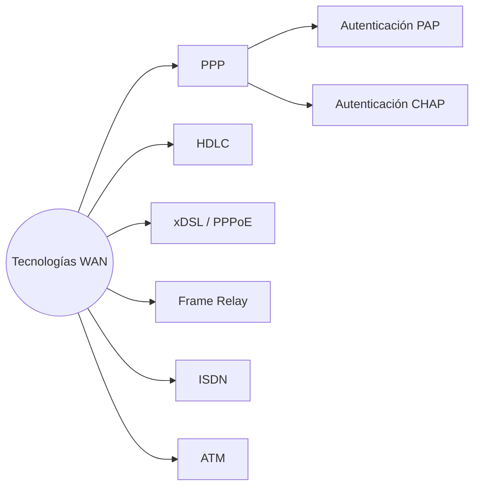
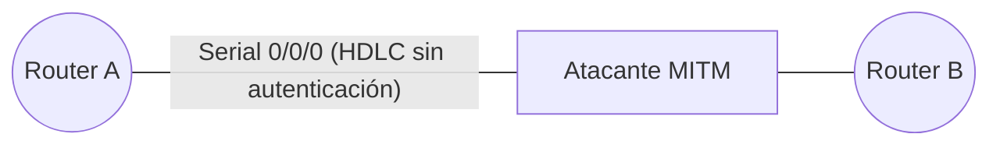
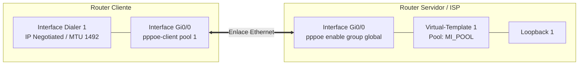
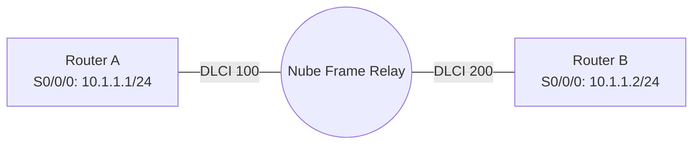
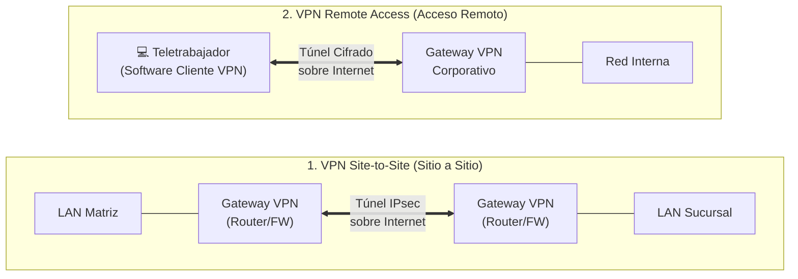
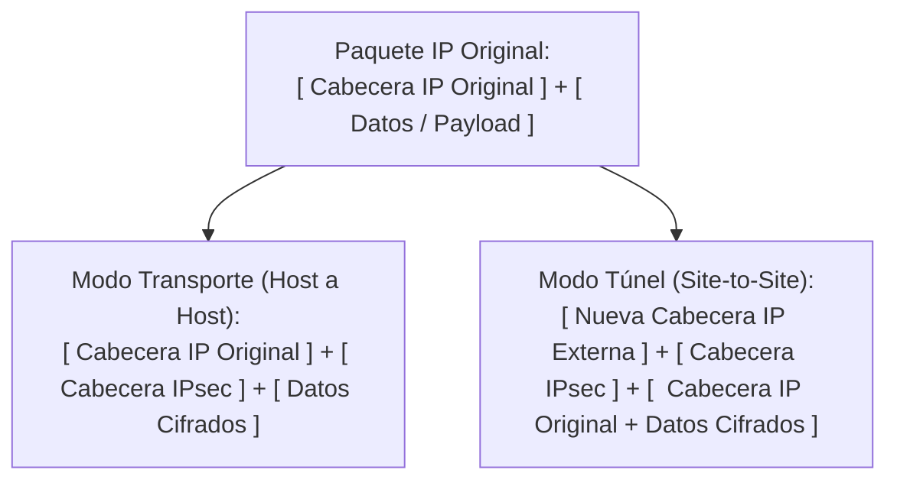

#  Protocolos de Enlace WAN en Cisco IOS

Apuntes sobre tecnologías de [[Capa de Enlace de Datos]] para redes [[WAN]], configuración de encapsulamientos seriales, autenticación punto a punto, túneles sobre Ethernet y conmutación de tramas.
## 1. Panorama de Tecnologías WAN

En el pizarrón se clasifican las principales tecnologías de acceso y encapsulamiento WAN:



- **Enlaces punto a punto tradicionales:** [[HDLC]] y [[PPP]] (con soporte para PAP y CHAP).
    
- **Banda ancha:** [[xDSL]] (implementado habitualmente mediante [[PPPoE]]).
    
- **Conmutación de circuitos y paquetes/celdas:** [[Frame Relay]], [[ISDN]] y [[ATM]].


## 2. HDLC (High-Level Data Link Control)

Protocolo de capa 2 síncrono orientado a bits. Es el encapsulamiento predeterminado en interfaces seriales de routers Cisco y **debe coincidir en ambos extremos del enlace**.

> [!warning] Riesgo de Seguridad (MITM) **HDLC** no incluye mecanismos nativos de autenticación ni cifrado. Un atacante con acceso físico al enlace serial puede interceptar el tráfico mediante un ataque **Man-in-the-Middle (MITM)** sin que los routers lo detecten.
> 
> imagen.jpg

Fragmento de código



### Configuración (en ambos extremos)

Fragmento de código

```
Router(config)# interface serial 0/0/0
Router(config-if)# encapsulation hdlc
```

## 3. PPP (Point-to-Point Protocol)

A diferencia de HDLC, **PPP** es un estándar abierto que soporta múltiples protocolos de capa 3, autenticación, compresión de datos y monitoreo de calidad del enlace.

Fragmento de código

```
sequenceDiagram
    participant C as Cliente / Router 1
    participant S as Servidor / Router 2

    Note over C,S: Autenticación PAP (2 vías - Texto plano)
    C->>S: Envía Usuario + Contraseña en texto claro
    S-->>C: ACK / NAK

    Note over C,S: Autenticación CHAP (3 vías - Hash MD5)
    S->>C: 1. Challenge (Desafío aleatorio)
    C->>S: 2. Response (Hash MD5 de ID + Secreto + Challenge)
    S-->>C: 3. Success / Failure
```

### A. PPP con Autenticación PAP

**PAP** (_Password Authentication Protocol_) envía las credenciales en **texto claro** en un proceso de dos vías (el cliente inicia el envío).

- **Extremo Servidor:** valida al usuario contra su base de datos local.
    

Fragmento de código

```
Router(config)# username ClienteR2 password MiClavePAP
Router(config)# interface serial 0/0/0
Router(config-if)# encapsulation ppp
Router(config-if)# ppp authentication pap
Router(config-if)# ppp compress predictor
Router(config-if)# ppp quality 80
```

- **Extremo Cliente:** envía explícitamente el usuario y contraseña configurados.

Fragmento de código

```
Router(config)# interface serial 0/0/0
Router(config-if)# encapsulation ppp
Router(config-if)# ppp pap sent-username ClienteR2 password MiClavePAP
Router(config-if)# ppp compress predictor
Router(config-if)# ppp quality 80
```

### B. PPP con Autenticación CHAP

**CHAP** (_Challenge Handshake Authentication Protocol_) es más seguro: utiliza un intercambio de tres vías con cifrado _hash_ MD5 y reautenticación periódica. Ambos routers deben tener configurado el **nombre del router vecino** y la **misma contraseña secreta**.


- **Router 1:**
    

Fragmento de código

```
Router1(config)# username Router2 password MiClaveSecreta
Router1(config)# interface serial 0/0/0
Router1(config-if)# encapsulation ppp
Router1(config-if)# ppp authentication chap
Router1(config-if)# ppp compress predictor
Router1(config-if)# ppp quality 50
```

- **Router 2:**
    

Fragmento de código

```
Router2(config)# username Router1 password MiClaveSecreta
Router2(config)# interface serial 0/0/0
Router2(config-if)# encapsulation ppp
Router2(config-if)# ppp authentication chap
Router2(config-if)# ppp compress predictor
Router2(config-if)# ppp quality 50
```

> [!info] Parámetros adicionales de PPP vistos en clase
> 
> - `ppp compress predictor`: Habilita la compresión de datos por software mediante el algoritmo Predictor.
>     
> - `ppp quality <1-100>`: Define el umbral mínimo de calidad del enlace (porcentaje de tramas recibidas sin error). Si cae por debajo del valor (`50` o `80`), el enlace se desactiva automáticamente.


## 4. PPPoE (PPP over Ethernet)

Permite encapsular tramas PPP dentro de tramas Ethernet, combinando las ventajas de autenticación y asignación dinámica de IP de PPP con redes de acceso masivo como xDSL.

Fragmento de código



### A. Configuración del Cliente PPPoE

La interfaz física actúa solo como transporte sin dirección IP; toda la lógica de capa 3 reside en la interfaz virtual `Dialer 1`:

Fragmento de código

```
! 1. Vincular interfaz física al pool de marcación
Router(config)# interface gigabitEthernet 0/0
Router(config-if)# no ip address
Router(config-if)# pppoe-client dial-pool-number 1
Router(config-if)# no shutdown
Router(config-if)# exit

! 2. Configurar interfaz lógica Dialer
Router(config)# interface Dialer 1
Router(config-if)# ip address negotiated
Router(config-if)# encapsulation ppp
Router(config-if)# dialer pool 1
Router(config-if)# ppp authentication chap callin
Router(config-if)# ppp chap hostname usuario@isp.com
Router(config-if)# ppp chap password 0 mi-password
Router(config-if)# ip mtu 1492
Router(config-if)# ip tcp adjust-mss 1452
Router(config-if)# exit

! 3. Ruta por defecto hacia el ISP
Router(config)# ip route 0.0.0.0 0.0.0.0 Dialer 1
```

> [!tip] ¿Por qué `ip mtu 1492` y `ip tcp adjust-mss 1452`? El encabezado PPPoE ocupa **8 bytes** (6 bytes PPPoE + 2 bytes Protocol ID PPP). Al restarlos de la MTU estándar de Ethernet (1500−8=1492 bytes1500 - 8 = 1492\text{ bytes}1500−8=1492 bytes), evitamos la fragmentación de paquetes. El MSS de TCP se ajusta restando 40 bytes de cabeceras IP/TCP (1492−40=1452 bytes1492 - 40 = 1452\text{ bytes}1492−40=1452 bytes).
> 

### B. Configuración del Servidor PPPoE

El servidor utiliza un grupo de acceso de banda ancha (`bba-group`) asociado a una plantilla virtual (`Virtual-Template`) que clona sesiones para cada cliente conectado:

Fragmento de código

```
! 1. Crear grupo BBA y vincular plantilla
Router(config)# bba-group pppoe global
Router(config-bba-group)# virtual-template 1
Router(config-bba-group)# exit

! 2. Configurar plantilla virtual
Router(config)# interface virtual-template 1
Router(config-if)# ip unnumbered loopback 1
Router(config-if)# peer default ip address pool MI_POOL
Router(config-if)# ppp authentication chap pap
Router(config-if)# exit

! 3. Habilitar PPPoE en la interfaz física
Router(config)# interface gigabitEthernet 0/0
Router(config-if)# no ip address
Router(config-if)# pppoe enable group global
Router(config-if)# no shutdown
Router(config-if)# exit

! 4. Credenciales locales del cliente
Router(config)# username cliente_pppoe password 0 mi_password
```

(Nota: En un laboratorio funcional, el `username` y `password` configurados en el servidor deben coincidir exactamente con el `ppp chap hostname` y `password` del cliente).

## 5. Frame Relay

Protocolo WAN de conmutación de paquetes que utiliza circuitos virtuales identificados localmente por un **DLCI** (_Data-Link Connection Identifier_). Al ser una red **NBMA** (_Non-Broadcast Multi-Access_), requiere mapear manualmente las direcciones IP remotas con los DLCI locales y habilitar la palabra clave `broadcast` para permitir el paso de protocolos de enrutamiento.

imagen.jpg

Fragmento de código



### Configuración de Router A

Asocia la IP del vecino (`10.1.1.2`) con su **DLCI local (`100`)**:

Fragmento de código

```
RouterA(config)# interface serial 0/0/0
RouterA(config-if)# ip address 10.1.1.1 255.255.255.0
RouterA(config-if)# encapsulation frame-relay
RouterA(config-if)# no shutdown
RouterA(config-if)# frame-relay map ip 10.1.1.2 100 broadcast
```

### Configuración de Router B

Asocia la IP del vecino (`10.1.1.1`) con su **DLCI local (`200`)**:

Fragmento de código

```
RouterB(config)# interface serial 0/0/0
RouterB(config-if)# ip address 10.1.1.2 255.255.255.0
RouterB(config-if)# encapsulation frame-relay
RouterB(config-if)# no shutdown
RouterB(config-if)# frame-relay map ip 10.1.1.1 200 broadcast
```

##  Resumen 

| Protocolo       | Tipo de Enlace         | Autenticación                       | Identificador / Dirección L2    | Uso Principal                                    |
| --------------- | ---------------------- | ----------------------------------- | ------------------------------- | ------------------------------------------------ |
| **HDLC**        | Punto a punto (Serial) | Ninguna (vulnerable a MITM)<br><br> | No aplica                       | Enlaces dedicados Cisco-a-Cisco<br><br>          |
| **PPP (PAP)**   | Punto a punto (Serial) | Texto claro (2 vías)<br><br>        | No aplica                       | Enlaces punto a punto legacy                     |
| **PPP (CHAP)**  | Punto a punto (Serial) | Hash MD5 (3 vías)<br><br>           | No aplica                       | Enlaces dedicados multi-fabricante<br><br>       |
| **PPPoE**       | Ethernet / xDSL        | PAP / CHAP<br>                      | MAC + Session ID                | Acceso a Internet de banda ancha (ISP)<br><br>   |
| **Frame Relay** | Conmutado (NBMA)       | Ninguna nativa                      | **DLCI** (ej. 100, 200)<br><br> | Interconexión de sucursales corporativas<br><br> |

### Componentes Físicos de una Red WAN

Fragmento de código


- **CPE (_Customer Premises Equipment_):** Equipos ubicados dentro de las instalaciones del cliente.
    
- **DTE (_Data Terminal Equipment_):** Dispositivo del cliente que entrega los datos al enlace (generalmente el **Router**).
    
- **DCE (_Data Circuit-terminating Equipment_):** Dispositivo del proveedor que convierte la señal y **suministra el reloj (`clock rate`)** (módem, CSU/DSU).
    
- **Punto de demarcación:** Límite físico donde termina la responsabilidad del cliente y empieza la del proveedor (ISP).
    
- **Bucle local (_Local Loop_ / Última milla):** Enlace físico entre el punto de demarcación y la Oficina Central (CO) del proveedor.
    

### 3.2 Clasificación de Enlaces WAN

|**Tipo de Enlace**|**Características**|**Ejemplos**|
|---|---|---|
|**Dedicados (Privados)**|Conexión punto a punto permanente, ancho de banda garantizado, baja latencia y costo alto.|Líneas arrendadas T1 (1.544 Mbps), E1 (2.048 Mbps), T3, E3|
|**Conmutados (Privados)**|Infraestructura compartida del proveedor mediante circuitos físicos o virtuales.|ISDN (circuitos), Frame Relay, ATM, MPLS (paquetes/celdas)|
|**Públicos**|Usan Internet como medio de transporte; económicos, pero exigen **VPN** para cifrar el tráfico.|xDSL, Cable coaxial, Fibra FTTH, 4G/5G|

### 3.3 Topologías WAN

- **Punto a Punto:** Enlace exclusivo entre dos sedes.
    
- **Hub-and-Spoke (Estrella):** Una sede central (_Hub_) conecta múltiples sucursales (_Spokes_). Las sucursales se comunican pasando por el Hub (punto único de fallo).
    
- **Malla Completa (_Full Mesh_):** Todos los nodos se conectan directamente entre sí. Alta redundancia y costo elevado: requiere $\frac{n(n-1)}{2}$ enlaces para $n$ nodos.
    
- **Malla Parcial (_Partial Mesh_):** Combina enlaces redundantes solo entre sedes críticas y conexiones en estrella para el resto.
    

### 3.4 Desarrollo de ISDN y ATM

- **ISDN (_Integrated Services Digital Network_):** Conmutación digital de circuitos sobre líneas telefónicas mediante canales **B** (64 kbps para voz/datos) y canales **D** (16 o 64 kbps para señalización):
    
    - **BRI (_Basic Rate Interface_):** `2B + 1D` (144 kbps) — hogares y pequeñas oficinas.
        
    - **PRI (_Primary Rate Interface_):** `23B + 1D` (T1, 1.544 Mbps en América) o `30B + 1D` (E1, 2.048 Mbps en Europa).
        
- **ATM (_Asynchronous Transfer Mode_):** Conmutación de alta velocidad basada en **celdas de longitud fija de 53 bytes** (**5 bytes** de cabecera VPI/VCI + **48 bytes** de carga útil), diseñada para garantizar latencia baja y predecible en voz y video.
    

### 3.5 Comandos Complementarios de Laboratorio y Diagnóstico

Fragmento de código

```
! Sincronización obligatoria en el extremo DCE (entornos Back-to-Back)
RouterDCE(config)# interface serial 0/0/0
RouterDCE(config-if)# clock rate 64000
```

- `show controllers serial 0/0/0`: Verifica si el cable conectado es **DCE** o **DTE**.
    
- `show interfaces serial 0/0/0`: Comprueba el estado físico/protocolo (`up/up`), el encapsulamiento activo y la MTU.
    
- `show frame-relay map`: Muestra las asociaciones activas entre IPs remotas y DLCI locales.
    
- `debug ppp authentication`: Depura en tiempo real el intercambio PAP (2 vías) o CHAP (3 vías).
    

### 3.6 Niveles de Seguridad en Redes VPN (IPsec)

- **Tipos de despliegue:**
    
    - **Site-to-Site:** Conecta redes completas (matriz $\leftrightarrow$ sucursal) entre routers/firewalls sin instalar software en los hosts.
        
    - **Remote Access:** Conecta usuarios individuales externos mediante un cliente VPN.
        
- **Pilares de seguridad IPsec:**
    
    - **Confidencialidad (Cifrado):** **AES** (128/192/256 bits) o 3DES _(DES es inseguro)_.
        
    - **Integridad (_Hashing_):** **SHA-2** (SHA-256/512) o MD5 _(legacy)_.
        
    - **Autenticación:** Claves precompartidas (**PSK**) o certificados digitales (**RSA / PKI**).
        
    - **Anti-repetición:** Números de secuencia que bloquean paquetes reenviados por un atacante.
        
- **Protocolos y modos IPsec:**
    
    - **AH (_Authentication Header_):** Garantiza integridad y autenticación, pero **no cifra** los datos.
        
    - **ESP (_Encapsulating Security Payload_):** Proporciona **cifrado (confidencialidad)**, integridad y autenticación.
        
    - **Modo Transporte:** Cifra solo los datos (_payload_), conservando la cabecera IP original (host a host).
        
    - **Modo Túnel:** Cifra **todo el paquete IP original** (cabecera + datos) y añade una nueva cabecera IP externa (usado en **Site-to-Site**).

####  Tipos de Despliegue VPN

Fragmento de código



#### . Comparativa de Encapsulamiento IPsec (Modo Transporte vs. Modo Túnel)

Fragmento de código


# Banco de Preguntas Tipo Examen: Protocolos WAN

> [!important] Regla del Examen (Formato del Profesor) Cada reactivo tiene **5 opciones (`a` – `e`)** y puede tener **una o varias respuestas correctas**. Para obtener el punto en el examen real, debes identificar **todos** los incisos correctos sin omitir ninguno ni marcar distractores. Despliega cada bloque de respuesta en Obsidian para autoevaluarte.

### 1. Respecto a las tecnologías y protocolos de acceso WAN, ¿cuáles afirmaciones son correctas?

a) [[PPP]] soporta autenticación mediante PAP y CHAP. 
b) [[xDSL]], [[Frame Relay]], [[ISDN]] y [[ATM]] son tecnologías utilizadas en redes WAN. 
c) [[HDLC]] incorpora cifrado nativo para evitar ataques _Man-in-the-Middle_ (MITM). 
d) [[PPPoE]] permite encapsular tramas PPP sobre enlaces Ethernet, usado comúnmente en xDSL.
e) Frame Relay es un protocolo punto a punto síncrono que no requiere mapeo de direcciones IP a identificadores de capa 2.

> [!success]- Ver respuesta y explicación
> 
> **Respuestas correctas:** `a`, `b`, `d`
> 
> - **Por qué son correctas:** PPP admite PAP y CHAP; xDSL, Frame Relay, ISDN y ATM forman parte de las tecnologías WAN; y PPPoE encapsula sesiones PPP sobre Ethernet.
>     
> - **Trampas:** `c)` es falsa porque HDLC carece de seguridad y es vulnerable a ataques MITM; `e)` es falsa porque Frame Relay es NBMA y sí requiere mapear IPs a DLCI.
>     

### 2. Sobre el protocolo HDLC en routers Cisco, ¿qué opciones son correctas?

a) Es el encapsulamiento predeterminado en interfaces seriales de Cisco. 
b) Debe configurarse con `encapsulation hdlc` en ambos extremos del enlace para establecer comunicación. 
c) Es vulnerable a ataques MITM (_Man-in-the-Middle_) porque no realiza autenticación. 
d) Utiliza un intercambio de tres vías (_3-way handshake_) para validar contraseñas mediante hash MD5.
e) Permite interoperabilidad nativa con equipos de otros fabricantes sin cambios de configuración.

> [!success]- Ver respuesta y explicación
> 
> **Respuestas correctas:** `a`, `b`, `c`
> 
> - **Por qué son correctas:** HDLC es el encapsulamiento serial por defecto en Cisco, requiere coincidir en ambos extremos y es vulnerable a MITM por falta de autenticación.
>     
> - **Trampas:** `d)` describe a PPP CHAP, y `e)` es falsa porque la implementación HDLC de Cisco es propietaria.
>     

### 3. ¿Cuáles son funciones o características configurables en el protocolo PPP?

a) Soporta autenticación mediante PAP y CHAP.
b) El comando `ppp compress predictor` habilita la compresión de datos por software en la interfaz.
c) El comando `ppp quality 80` desactiva el enlace si el porcentaje de calidad cae por debajo del 80 %. 
d) Solo funciona sobre interfaces Ethernet y no puede aplicarse en enlaces seriales.
e) Se activa en la interfaz serial mediante el comando `encapsulation ppp`.

> [!success]- Ver respuesta y explicación
> 
> **Respuestas correctas:** `a`, `b`, `c`, `e`
> 
> - **Por qué son correctas:** Todos son parámetros estándar de PPP en enlaces seriales.
>     
> - **Trampa:** `d)` es falsa; PPP nació para enlaces seriales punto a punto (para Ethernet se requiere PPPoE).
>     

### 4. Respecto a la autenticación PPP con PAP, ¿qué afirmaciones son correctas?

a) Envía el nombre de usuario y la contraseña en texto claro (sin cifrar) en un proceso de dos vías. b) En el extremo servidor se configura `ppp authentication pap` y una cuenta local con `username`. 
c) En el extremo cliente se utiliza `ppp pap sent-username <usuario> password <clave>` dentro de la interfaz. 
d) El servidor inicia el proceso enviando un desafío aleatorio (_Challenge_) al cliente. 
e) Ofrece mayor seguridad que CHAP frente a la captura de tráfico en el enlace.

> [!success]- Ver respuesta y explicación
> 
> **Respuestas correctas:** `a`, `b`, `c`
> 
> - **Por qué son correctas:** PAP transmite credenciales en texto plano en 2 vías; el servidor valida contra su base local (`username`) y el cliente las envía con `ppp pap sent-username`.
>     
> - **Trampas:** `d)` y `e)` corresponden a CHAP, no a PAP.
>     

### 5. Sobre la configuración y funcionamiento de PPP con CHAP, ¿cuáles opciones son correctas?

a) Realiza la autenticación mediante un intercambio de tres vías (_3-way handshake_). 
b) Ambos routers deben configurar el comando `username` con el _hostname_ del router vecino y la misma contraseña secreta.
c) Se habilita en la interfaz serial con el comando `ppp authentication chap`. 
d) Transmite la contraseña en texto plano únicamente durante la negociación inicial del enlace. 
e) Utiliza valores aleatorios (_Challenge_) y cifrado _hash_ MD5 para evitar ataques de repetición.

> [!success]- Ver respuesta y explicación
> 
> **Respuestas correctas:** `a`, `b`, `c`, `e`
> 
> - **Por qué son correctas:** En CHAP ambos extremos configuran `username <nombre_vecino> password <secreto_compartido>` y `ppp authentication chap`, operando en 3 vías con MD5.
>     
> - **Trampa:** `d)` es falsa; CHAP nunca envía la contraseña por el enlace.
>     

### 6. ¿Qué método de autenticación PPP utiliza un intercambio de tres vías con hash MD5 para validar la identidad sin enviar la contraseña por el enlace?

a) PAP 
b) HDLC
c) CHAP 
d) Frame Relay Inverse-ARP
e) PPPoE Discovery

> [!success]- Ver respuesta y explicación
> 
> **Respuesta correcta:** `c`
> 
> - **Explicación:** **CHAP** (_Challenge Handshake Authentication Protocol_) es el único protocolo de la lista que emplea un saludo de tres vías con desafío aleatorio y hash MD5.
>     

### 7. Sobre la configuración de un cliente PPPoE en Cisco IOS, ¿qué comandos o prácticas son correctas?

a) La interfaz física (ej. `GigabitEthernet0/0`) se configura con `no ip address` y `pppoe-client dial-pool-number 1`. 
b) La interfaz lógica `Dialer 1` obtiene su dirección IP dinámicamente mediante `ip address negotiated`.
c) Se configura `ip mtu 1492` en la interfaz `Dialer 1` para compensar los 8 bytes de cabecera PPPoE. 
d) El comando `ip tcp adjust-mss` ajusta el tamaño máximo de segmento TCP para evitar fragmentación. 
e) La ruta estática por defecto hacia el ISP debe apuntar a la interfaz física (`ip route 0.0.0.0 0.0.0.0 GigabitEthernet0/0`).

> [!success]- Ver respuesta y explicación
> 
> **Respuestas correctas:** `a`, `b`, `c`, `d`
> 
> - **Por qué son correctas:** La interfaz física solo transporta tramas sin IP; la capa 3 reside en `Dialer 1` con MTU 1492 y ajuste de MSS.
>     
> - **Trampa:** `e)` es falsa; la ruta por defecto debe apuntar a la interfaz lógica `Dialer 1` (`ip route 0.0.0.0 0.0.0.0 Dialer 1`).
>     

### 8. Respecto a la configuración del servidor PPPoE en Cisco IOS, ¿cuáles afirmaciones son correctas?

a) Se crea un grupo de banda ancha mediante `bba-group pppoe global` asociado a un `virtual-template`. 
b) La interfaz `virtual-template 1` asigna direcciones IP a los clientes con `peer default ip address pool <nombre>`. 
c) En la interfaz `virtual-template 1` se habilita la autenticación con `ppp authentication chap pap`. 
d) La interfaz física del servidor requiere una dirección IP estática y el comando `pppoe-client`. e) Las credenciales del cliente se registran en modo global con `username <usuario> password 0 <clave>`.

> [!success]- Ver respuesta y explicación
> 
> **Respuestas correctas:** `a`, `b`, `c`, `e`
> 
> - **Por qué son correctas:** El servidor usa `bba-group`, `virtual-template 1` con `ip unnumbered loopback 1` y `peer default ip address pool`, además de usuarios locales.
>     
> - **Trampa:** `d)` es falsa; la interfaz física del servidor lleva `no ip address` y `pppoe enable group global`.
>     

### 9. ¿Cuál es el valor de MTU configurado en la interfaz `Dialer` de un cliente PPPoE para evitar la fragmentación de paquetes sobre Ethernet estándar?

a) 1500 bytes
b) 1492 bytes 
c) 1452 bytes 
d) 1480 bytes 
e) 1518 bytes

> [!success]- Ver respuesta y explicación
> 
> **Respuesta correcta:** `b`
> 
> - **Explicación:** Al restar los 8 bytes de cabecera PPPoE + PPP a los 1500 bytes de Ethernet estándar, resulta una MTU máxima de **1492 bytes**. (`1452` corresponde al valor de TCP MSS, no a la MTU).
>     

### 10. Respecto al protocolo Frame Relay y su configuración en interfaces seriales, ¿qué afirmaciones son correctas?

a) Se habilita en la interfaz mediante el comando `encapsulation frame-relay`. 
b) Utiliza identificadores de circuito virtual llamados DLCI (_Data-Link Connection Identifier_).
c) El comando `frame-relay map ip <IP_vecino> <DLCI_local> broadcast` asocia la IP remota con el DLCI local. 
d) La palabra clave `broadcast` permite el reenvío de tráfico broadcast/multicast necesario para protocolos de enrutamiento dinámico.
e) En el comando `frame-relay map ip`, se debe especificar el número de DLCI configurado en el router remoto.

> [!success]- Ver respuesta y explicación
> 
> **Respuestas correctas:** `a`, `b`, `c`, `d`
> 
> - **Por qué son correctas:** Frame Relay usa `encapsulation frame-relay`, DLCI locales y el parámetro `broadcast` para emular difusión sobre redes NBMA.
>     
> - **Trampa clásica:** `e)` es falsa; el DLCI tiene significado **local**, por lo que siempre se mapea la **IP remota** contra el **DLCI local**.
>     

### 11. En una topología Frame Relay donde Router A (`10.1.1.1/24`) tiene asignado el DLCI local `100` y Router B (`10.1.1.2/24`) tiene asignado el DLCI local `200`, ¿qué comandos son correctos?

a) En Router A: `frame-relay map ip 10.1.1.2 100 broadcast`
b) En Router A: `frame-relay map ip 10.1.1.1 200 broadcast` 
c) En Router B: `frame-relay map ip 10.1.1.1 200 broadcast` 
d) En Router B: `frame-relay map ip 10.1.1.2 100 broadcast` 
e) En ambos routers se debe ejecutar `no shutdown` para activar la interfaz serial.

> [!success]- Ver respuesta y explicación
> 
> **Respuestas correctas:** `a`, `c`, `e`
> 
> - **Explicación:** Router A apunta a la IP de Router B (`10.1.1.2`) usando su propio DLCI local (`100`), mientras que Router B apunta a la IP de Router A (`10.1.1.1`) usando su propio DLCI local (`200`).
>     

### 12. Identifica cuáles de las siguientes configuraciones provocarían un FALLO en el establecimiento o funcionamiento del enlace WAN:

a) Configurar `encapsulation hdlc` en Router A y `encapsulation ppp` en Router B. 
b) Configurar contraseñas distintas en el comando `username` al utilizar PPP CHAP.
c) Asignar una dirección IP estática en la interfaz física `GigabitEthernet0/0` de un cliente PPPoE en lugar de `no ip address`.
d) Configurar `ip mtu 1492` en la interfaz `Dialer 1` del cliente PPPoE.
e) Omitir el comando `no shutdown` en una interfaz serial física recién configurada.

> [!success]- Ver respuesta y explicación
> 
> **Respuestas correctas:** `a`, `b`, `c`, `e`
> 
> - **Por qué provocan fallo:** Los encapsulamientos deben coincidir en ambos extremos (`a`), las contraseñas CHAP deben ser idénticas (`b`), la interfaz física PPPoE no debe llevar IP (`c`) y las interfaces de router vienen apagadas por defecto (`e`).
>     
> - **No provoca fallo:** `d)` es la configuración correcta recomendada para PPPoE.
>

### 13. Respecto a los modos de configuración de Cisco IOS utilizados en enlaces WAN, ¿qué afirmaciones son correctas?

a) `username Router2 password MiClaveSecreta` se ejecuta en modo de configuración global `(config)#`. b) `encapsulation frame-relay` se ejecuta dentro del modo de configuración de interfaz `(config-if)#`. c) `virtual-template 1` (al vincularlo al grupo PPPoE) se ejecuta dentro del modo `(config-bba-group)#`. d) `ip route 0.0.0.0 0.0.0.0 Dialer 1` se configura dentro de la interfaz `(config-if)#`. e) `pppoe enable group global` se configura dentro de la interfaz física en modo `(config-if)#`.

> [!success]- Ver respuesta y explicación
> 
> **Respuestas correctas:** `a`, `b`, `c`, `e`
> 
> - **Por qué son correctas:** Los usuarios locales son globales; el encapsulamiento y la activación de PPPoE van en la interfaz física; y la plantilla virtual se asocia dentro del submodo `bba-group`.
>     
> - **Trampa:** `d)` es falsa; las rutas estáticas (`ip route`) siempre se ejecutan en modo de configuración global `(config)#`.
>     

### 14. Sobre los comandos aplicados dentro de la interfaz `Dialer 1` en un cliente PPPoE, ¿cuáles opciones son correctas?

a) `ppp authentication chap callin` permite que el cliente responda a la autenticación CHAP iniciada por el servidor. 
b) `dialer pool 1` vincula la interfaz lógica `Dialer 1` con el `pppoe-client dial-pool-number 1` de la interfaz física. 
c) `ppp chap hostname` y `ppp chap password` definen las credenciales que el cliente presentará al servidor ISP. 
d) `ip tcp adjust-mss` ajusta el tamaño máximo de segmento TCP para evitar la fragmentación causada por la cabecera PPPoE. 
e) `ip address dhcp` es el comando obligatorio en `Dialer 1` para obtener la dirección IP del servidor.

> [!success]- Ver respuesta y explicación
> 
> **Respuestas correctas:** `a`, `b`, `c`, `d`
> 
> - **Por qué son correctas:** Todos son parámetros estándar de `Dialer 1` vistos en el pizarrón para negociar la sesión PPPoE y evitar fragmentación.
>     
> - **Trampa:** `e)` es falsa; en PPPoE se utiliza `ip address negotiated` (negociación mediante IPCP de PPP), no DHCP.
>     

### 15. Respecto a la configuración del servidor PPPoE en Cisco IOS, ¿qué afirmaciones son correctas?

a) `ip unnumbered loopback 1` permite que `virtual-template 1` tome prestada la IP de `Loopback 1` sin gastar una subred adicional.
b) `peer default ip address pool MI_POOL` define el conjunto de direcciones IP que se asignarán a los clientes conectados. 
c) `ppp authentication chap pap` habilita autenticación CHAP y permite PAP como alternativa de respaldo. 
d) El `0` en `username cliente_pppoe password 0 mi_password` indica que la contraseña se escribe en texto claro. 
e) En el servidor PPPoE, la interfaz física `GigabitEthernet0/0` debe tener configurada una IP del mismo rango que `MI_POOL`.

> [!success]- Ver respuesta y explicación
> 
> **Respuestas correctas:** `a`, `b`, `c`, `d`
> 
> - **Por qué son correctas:** La plantilla virtual toma la IP de `Loopback 1`, reparte direcciones desde `MI_POOL`, negocia `chap pap` y valida contra la cuenta local en texto plano (`0`).
>     
> - **Trampa:** `e)` es falsa; la interfaz física del servidor lleva `no ip address` y `pppoe enable group global`.
>     

### 16. Sobre la asimetría en la configuración de PPP con autenticación PAP, ¿cuáles afirmaciones son correctas?

a) El extremo servidor configura `ppp authentication pap`, mientras que el extremo cliente configura `ppp pap sent-username`. 
b) El nombre de usuario configurado en `username` en el servidor debe coincidir con el `sent-username` enviado por el cliente.
c) Ambos extremos deben tener configurado `encapsulation ppp` en la interfaz serial. 
d) El comando `ppp pap sent-username` se configura en modo de configuración global `(config)#`. 
e) Si las contraseñas no coinciden, el enlace físico sube (`up`), pero el protocolo de línea permanece caído (`down`).

> [!success]- Ver respuesta y explicación
> 
> **Respuestas correctas:** `a`, `b`, `c`, `e`
> 
> - **Por qué son correctas:** PAP es asimétrico (el servidor valida y el cliente envía credenciales); requiere `encapsulation ppp` en ambos lados y, si falla la autenticación, la capa 2 (protocolo de línea) no levanta.
>     
> - **Trampa:** `d)` es falsa; `ppp pap sent-username` se aplica dentro de la interfaz `(config-if)#`.
>     

### 17. Respecto a los comandos adicionales de optimización y monitoreo en PPP (`compress` y `quality`), ¿qué opciones son correctas?

a) `ppp compress predictor` habilita la compresión de datos por software mediante el algoritmo Predictor. 
b) `ppp quality 50` desactiva automáticamente el enlace si el porcentaje de calidad cae por debajo del 50 %. 
c) `ppp quality 80` es más estricto que `ppp quality 50`, ya que exige un mayor porcentaje de tramas recibidas sin error. 
d) El comando `ppp quality` cifra los datos con MD5 para protegerlos contra ataques MITM. e) Ambos comandos se configuran dentro del modo de interfaz `(config-if)#`.

> [!success]- Ver respuesta y explicación
> 
> **Respuestas correctas:** `a`, `b`, `c`, `e`
> 
> - **Por qué son correctas:** `compress predictor` comprime tramas y `quality <1-100>` monitorea la calidad del enlace en `(config-if)#`, siendo `80` un umbral más exigente que `50`.
>     
> - **Trampa:** `d)` es falsa; `ppp quality` mide calidad del enlace (LQM), no realiza cifrado ni autenticación.
>     

### 18. Sobre la seguridad en enlaces WAN y el riesgo de ataques _Man-in-the-Middle_ (MITM), ¿qué afirmaciones son correctas?

a) Un enlace serial con `encapsulation hdlc` es vulnerable a ataques MITM porque carece de mecanismos de autenticación. 
b) PPP con PAP protege las contraseñas contra captura de tráfico porque las cifra antes de transmitirlas. 
c) PPP con CHAP mitiga la captura de contraseñas al validar mediante un desafío aleatorio y un hash MD5 sin enviar la clave por el enlace. 
d) Migrar un enlace de HDLC a PPP CHAP requiere cambiar el encapsulamiento en ambos extremos del enlace. 
e) Frame Relay incluye autenticación CHAP nativa en cada circuito virtual DLCI.

> [!success]- Ver respuesta y explicación
> 
> **Respuestas correctas:** `a`, `c`, `d`
> 
> - **Por qué son correctas:** HDLC no autentica y expone el enlace a MITM; CHAP protege la clave mediante desafío/hash MD5 en 3 vías; y ambos extremos deben usar `encapsulation ppp`.
>     
> - **Trampas:** `b)` es falsa porque PAP envía credenciales en texto claro; `e)` es falsa porque Frame Relay no incluye autenticación CHAP nativa.
>     

### 19. Respecto al comportamiento NBMA y el mapeo estático en Frame Relay, ¿cuáles afirmaciones son correctas?

a) En `frame-relay map ip 10.1.1.2 100 broadcast`, la IP `10.1.1.2` pertenece a la interfaz del router vecino remoto. 
b) En `frame-relay map ip 10.1.1.2 100 broadcast`, el valor `100` corresponde al DLCI local asignado al router que se está configurando. 
c) Omitir la palabra clave `broadcast` impide el envío de actualizaciones de protocolos de enrutamiento dinámico sobre el circuito virtual. 
d) Para establecer conectividad, el DLCI configurado en Router A debe ser exactamente el mismo número que en Router B. 
e) Antes de ejecutar `frame-relay map ip`, se debe configurar `encapsulation frame-relay` en la interfaz serial.

> [!success]- Ver respuesta y explicación
> 
> **Respuestas correctas:** `a`, `b`, `c`, `e`
> 
> - **Por qué son correctas:** El mapeo asocia la **IP remota** con el **DLCI local**, requiere `encapsulation frame-relay` previo y necesita `broadcast` para emular difusión en redes NBMA.
>     
> - **Trampa:** `d)` es falsa; el DLCI tiene significado **local** (en clase se usó `100` en Router A y `200` en Router B).
>     

### 20. Sobre la clasificación de tecnologías WAN vista en clase, ¿qué opciones son correctas?

a) [[ISDN]] (_Integrated Services Digital Network_) es una tecnología WAN digital de conmutación de circuitos.
b) [[ATM]] (_Asynchronous Transfer Mode_) transmite información utilizando celdas de longitud fija.
c) [[xDSL]] aprovecha líneas telefónicas de cobre para acceso de banda ancha, implementándose habitualmente con [[PPPoE]]. 
d) [[PPP]] soporta los protocolos de autenticación PAP y CHAP.
e) Frame Relay y ATM son protocolos diseñados exclusivamente para redes LAN de área local.

> [!success]- Ver respuesta y explicación
> 
> **Respuestas correctas:** `a`, `b`, `c`, `d`
> 
> - **Por qué son correctas:** Todas corresponden al mapa de tecnologías WAN del pizarrón (PPP con PAP/CHAP, xDSL, Frame Relay, ISDN y ATM).
>     
> - **Trampa:** `e)` es falsa; Frame Relay y ATM son tecnologías de red de área amplia (WAN).
>     

### 21. Al auditar un enlace PPP CHAP entre `Router1` y `Router2`, ¿cuáles de las siguientes configuraciones provocarían un FALLO en la autenticación?

a) Configurar `username Router1 password MiClaveSecreta` en `Router1` y `username Router2 password MiClaveSecreta` en `Router2`.
b) Configurar `encapsulation ppp` en `Router1` y `encapsulation hdlc` en `Router2`. 
c) Configurar contraseñas distintas en el comando `username` de cada router. 
d) Configurar `ppp quality 50` en `Router1` y `ppp quality 80` en `Router2`. 
e) Omitir el comando `ppp authentication chap` en la interfaz `serial 0/0/0`.

> [!success]- Ver respuesta y explicación
> 
> **Respuestas correctas:** `a`, `b`, `c`, `e`
> 
> - **Por qué provocan fallo:** En `a)` cada router configuró su propio nombre en lugar del nombre del router vecino; en `b)` los encapsulamientos no coinciden; en `c)` las claves secretas difieren; y en `e)` no se exige autenticación CHAP.
>     
> - **No provoca fallo:** `d)` es válida; los umbrales de calidad (`50` y `80`) pueden diferir sin impedir la autenticación.
>     

### 22. En la configuración del servidor PPPoE, ¿qué función cumple el comando `ip unnumbered loopback 1` dentro de `interface virtual-template 1`?

a) Deshabilita por completo el enrutamiento IPv4 en las sesiones PPPoE. 
b) Permite que la interfaz virtual utilice la dirección IP de `Loopback 1` sin consumir una subred adicional. 
c) Asigna la dirección `127.0.0.1` como puerta de enlace a todos los clientes conectados. 
d) Crea un pool dinámico de direcciones IP llamado `loopback 1`. 
e) Habilita NAT sobrecargado (PAT) hacia Internet automáticamente.

> [!success]- Ver respuesta y explicación
> 
> **Respuesta correcta:** `b`
> 
> - **Explicación:** `ip unnumbered loopback 1` permite que la interfaz lógica `Virtual-Template 1` tome prestada la dirección IP configurada en `Loopback 1` para operar en capa 3 sin desperdiciar direccionamiento IP adicional.
>     

### 23. En un router cliente PPPoE, ¿qué par de comandos vincula la interfaz física `GigabitEthernet0/0` con la interfaz lógica `Dialer 1`?

a) `bba-group pppoe global` y `virtual-template 1`
b) `pppoe enable group global` y `ip address negotiated` 
c) `pppoe-client dial-pool-number 1` y `dialer pool 1`
d) `encapsulation ppp` y `ip mtu 1492` 
e) `frame-relay map ip` y `no shutdown`

> [!success]- Ver respuesta y explicación
> 
> **Respuesta correcta:** `c`
> 
> - **Explicación:** En la interfaz física se declara `pppoe-client dial-pool-number 1` y en la interfaz virtual `Dialer 1` se enlaza mediante `dialer pool 1`.
>     

### 24. Sobre los comandos de configuración WAN en Cisco IOS, ¿qué afirmaciones son correctas?

a) `no shutdown` activa administrativamente una interfaz serial o GigabitEthernet.
b) `no ip address` en la interfaz física de un enlace PPPoE deshabilita por completo el paso de tramas PPPoE. 
c) `ip route 0.0.0.0 0.0.0.0 Dialer 1` establece una ruta estática predeterminada saliendo por la interfaz lógica de marcación. 
d) `ppp authentication chap pap` en el servidor PPPoE intenta autenticar primero con CHAP y acepta PAP si el cliente no soporta CHAP. 
e) `encapsulation hdlc` requiere configurar obligatoriamente un `username` y `password` en modo global.

> [!success]- Ver respuesta y explicación
> 
> **Respuestas correctas:** `a`, `c`, `d`
> 
> - **Por qué son correctas:** `no shutdown` levanta la interfaz; la ruta por defecto del cliente PPPoE apunta a `Dialer 1`; y `chap pap` establece orden de preferencia de autenticación en el servidor.
>     
> - **Trampas:** `b)` es falsa porque `no ip address` es un requisito normal en la interfaz física PPPoE (capa 2); `e)` es falsa porque HDLC no soporta ni requiere autenticación.


