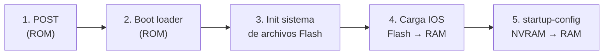
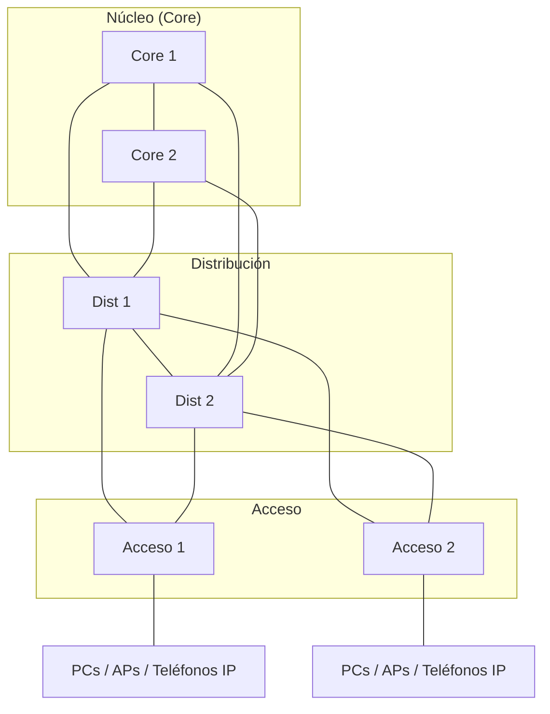
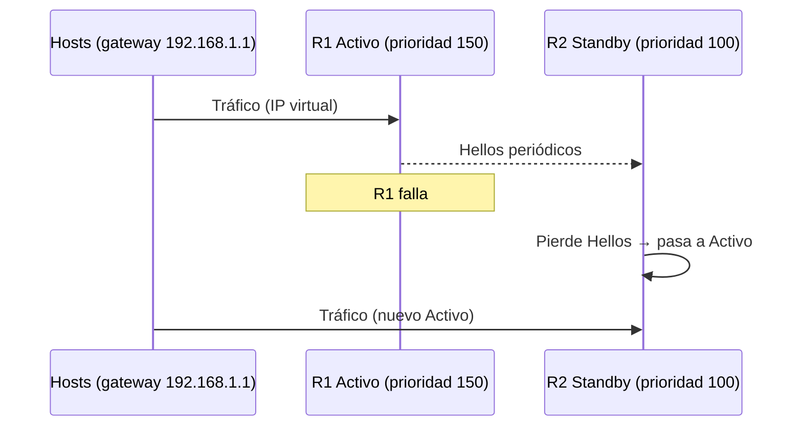
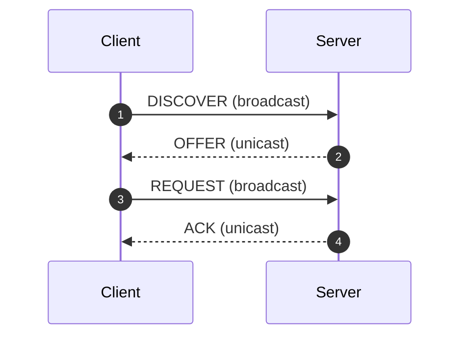
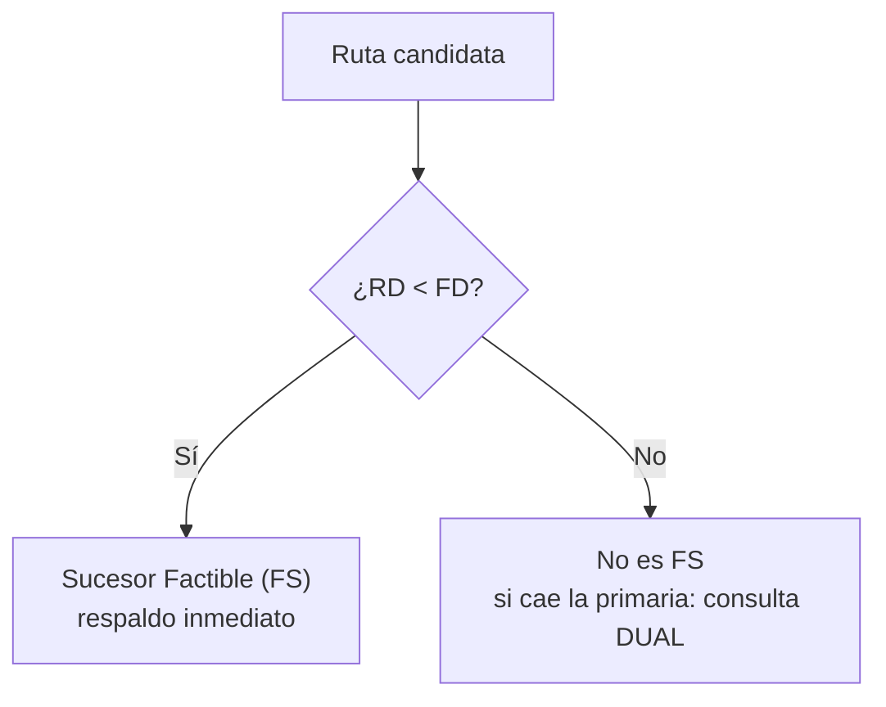
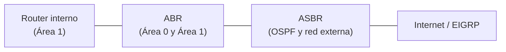

---
tags:
  - ccna
  - redes
aliases:
  - CCNA Unidad 2
  - Conmutación LAN
---
#  Unidad 2 — Conmutación de Redes LAN (CCNA)

## Progreso de estudio

- [ ] 1. Switch: arranque, SVI y puertos
- [ ] 2. Port Security y errores de interfaz
- [ ] 3. VLANs, trunks, DTP y VTP
- [ ] 4. Diseño jerárquico
- [ ] 5. STP
- [ ] 6. EtherChannel
- [ ] 7. Routing Inter-VLAN
- [ ] 8. FHRP / HSRP
- [ ] 9. ACLs
- [ ] 10. DHCP y NAT
- [ ] 11. EIGRP
- [ ] 12. OSPF
- [ ] Troubleshooting y comandos
- [ ] Banco de preguntas (>80 %)
- [ ] Flashcards repasadas

---

## Hoja de números

> [!abstract] Repásala el día antes del examen

| Tema | Dato clave |
| --- | --- |
| Memorias | **ROM**: POST + bootloader · **Flash**: IOS · **NVRAM**: startup-config · **RAM**: running-config |
| Port Security (default) | ==Deshabilitado==, **1** MAC, violación **Shutdown** |
| Runts / Giants | Runt < **64 B** · Giant > **1518 B** |
| VLAN normal / extendida | **1–1005** (`vlan.dat`, Flash) · **1006–4094** (`running-config`) |
| 802.1Q | Etiqueta de **4 bytes** · EtherType `0x8100` · VID de **12 bits** |
| VLAN de voz | Retardo < **150 ms** |
| STP: costos | 10 Gbps=**2** · 1 Gbps=**4** · 100 Mbps=**19** · 10 Mbps=**100** |
| STP: prioridad default | **32768** (gana el BID más bajo) |
| ACL estándar / extendida | **1–99** / **100–199** (+ 1300–1999 / 2000–2699) |
| Ubicación ACL | Estándar → cerca del **DESTINO** · Extendida → cerca del **ORIGEN** |
| HSRP | Prioridad default **100** · v1 `224.0.0.2` · v2 `224.0.0.102` |
| EIGRP | AD **90** interna / **170** externa / **5** resumen · multicast `224.0.0.10` |
| OSPF | AD **110** · `224.0.0.5` (todos) · `224.0.0.6` (DR/BDR) |
| OSPF DR | Prioridad **0–255** (default 1) · **0 = nunca DR/BDR** |

---

## 1. Switch: arranque, SVI y puertos

### Secuencia de arranque



> [!tip] Regla mnemotécnica
> **P**rimero **B**ásico, **F**lash, **I**OS, **C**onfig → *POST, Bootloader, Flash, IOS, Config.*

- El comando `boot system` define qué IOS cargar de Flash (variable `BOOT`). Se verifica con `show boot`.
- **Recuperación** (IOS dañado o ausente): mantener botón ==Mode== al encender hasta que el LED pase de ámbar a verde sólido → aparece el prompt `switch:`.

### SVI (administración remota)

Un switch de Capa 2 **no enruta**, pero necesita una IP en una SVI para administrarse por SSH/Telnet.

```
S1(config)# interface vlan 99
S1(config-if)# ip address 172.17.99.11 255.255.255.0
S1(config-if)# no shutdown
S1(config)# ip default-gateway 172.17.99.1
```

> [!warning]  Trampa
> Sin `ip default-gateway`: la administración **en la misma subred funciona**, pero **falla desde otra red**.

### Dúplex y Auto-MDIX

- **Full-duplex**: envía y recibe a la vez → sin colisiones. **Half-duplex**: uno u otro → pueden ocurrir colisiones.
- **Auto-MDIX** detecta si el cable es directo o cruzado.

> [!warning]  Trampa
> Para usar `mdix auto`, `speed auto` y `duplex auto` **deben estar en automático**.

---

## 2. Port Security y errores de interfaz

### Port Security

Limita qué direcciones MAC pueden usar un puerto (puerto en modo access).

| Valor por defecto | |
| --- | --- |
| Estado | Deshabilitado |
| Máx. MACs | 1 |
| Violación | Shutdown |

**Tipos de MAC segura**

| Tipo | Cómo se obtiene | Persistencia |
| --- | --- | --- |
| **Estática** | Manual: `switchport port-security mac-address <MAC>` | running-config |
| **Dinámica** | Aprendida automáticamente | Se borra al reiniciar |
| **Sticky** | Aprendida automáticamente | ==Se agrega a la running-config== |

```
S1(config-if)# switchport mode access
S1(config-if)# switchport port-security
S1(config-if)# switchport port-security maximum 2
S1(config-if)# switchport port-security mac-address sticky
S1(config-if)# switchport port-security violation restrict
```

**Modos de violación**

| Modo                   | Reenvía tráfico |            Syslog            | Contador | Apaga puerto (err-disabled) |
| ---------------------- | :-------------: | :--------------------------: | :------: | :-------------------------: |
| **Protect**            |        ❌        |              ❌               |    ❌     |              ❌              |
| **Restrict**           |        ❌        |              +               |    +     |              ❌              |
| **Shutdown** (default) |        ❌        | ❌ (muestra error en consola) |    +     |              +              |

> [!tip] Truco
> Protect = **silencioso** · Restrict = **avisa** (syslog) · Shutdown = **apaga**.

> [!example] Recuperar un puerto `err-disabled`
> ```
> S1(config-if)# shutdown
> S1(config-if)# no shutdown
> ```

### Errores en `show interfaces`

| Error | Significado | Causa típica |
| --- | --- | --- |
| **Runts** | Tramas **< 64 bytes** | Colisiones / problemas de NIC |
| **Giants** | Tramas **> 1518 bytes** | Tramas sobredimensionadas |
| **CRC** | Checksum no coincide | ==Ruido eléctrico / EMI==, cable dañado |
| **Late collisions** | Colisión después de 512 bits | ==Duplex mismatch== |

---

## 3. VLANs, trunks, DTP y VTP

### Tipos de VLAN

- **VLAN 1 (default)**: todos los puertos por defecto; administración y nativa por defecto. ==No se puede eliminar ni renombrar==.
- **VLAN nativa**: transporta tráfico **sin etiqueta** en un trunk 802.1Q. ==Debe coincidir en ambos extremos==.
- **VLAN de voz**: ancho de banda garantizado, prioridad (QoS), retardo < **150 ms**.

### Rangos

| Rango | IDs | Se guarda en | Notas |
| --- | --- | --- | --- |
| **Normal** | 1–1005 | `vlan.dat` (**Flash**) | 1002–1005 reservadas (Token Ring/FDDI), no se borran. VTP las reconoce |
| **Extendido** | 1006–4094 | `running-config` | VTP antiguo **no** las soporta |

### Etiquetado IEEE 802.1Q

Inserta **4 bytes** en la trama Ethernet:

| Campo | Tamaño | Función |
| --- | --- | --- |
| EtherType `0x8100` | 2 B | Indica que la trama tiene etiqueta 802.1Q |
| Prioridad (Pri) | 3 bits | QoS |
| CFI | 1 bit | Formato canónico |
| **VID** | 12 bits | ID de VLAN (hasta 4096 valores) |

### DTP (Dynamic Trunking Protocol)

Protocolo **propietario de Cisco** que negocia el trunk automáticamente.

| Local ↓ / Remoto → |   Auto    | Desirable |   Trunk   |  Access  |
| ------------------ | :-------: | :-------: | :-------: | :------: |
| **Auto**           |  Access   | **Trunk** | **Trunk** |  Access  |
| **Desirable**      | **Trunk** | **Trunk** | **Trunk** |  Access  |
| **Trunk**          | **Trunk** | **Trunk** | **Trunk** | Limitado |
| **Access**         |  Access   |  Access   | Limitado  |  Access  |

> [!tip] Truco
> **Auto** es pasivo (espera). **Desirable** invita. `Auto + Auto` = **Access** (nadie inicia).

### VTP (VLAN Trunking Protocol)

Administra VLANs de **rango normal** de forma centralizada en un dominio. Guarda en `vlan.dat`.

| Modo             |        Crea/modifica/elimina VLANs        | Sincroniza con anuncios | Reenvía anuncios |
| ---------------- | :---------------------------------------: | :---------------------: | :--------------: |
| **Servidor**     |                     +                     |            +            |        +         |
| **Cliente**      |                     ❌                     |            +            |        +         |
| **Transparente** | + (solo locales; permite rango extendido) |            ❌            |        +         |

> [!danger]  Trampa clásica
> **Número de revisión** (32 bits): sube con cada cambio. Un switch con revisión **más alta** sobrescribe las VLANs de todo el dominio. Un switch nuevo con revisión alta puede **borrar la red**.

---

## 4. Diseño jerárquico de la LAN



| Capa | Función clave |
| --- | --- |
| **Acceso** | Conecta dispositivos finales · **Port Security** · asignación de **VLANs** |
| **Distribución** | **Agrega** tráfico de acceso · **Routing Inter-VLAN** · define límites de broadcast |
| **Núcleo (Core)** | Backbone de **alta velocidad**, conmuta lo más rápido posible |

---

## 5. STP (Spanning Tree Protocol)

STP (802.1D) evita **bucles de Capa 2** (tormentas de broadcast, tramas duplicadas, tabla MAC inestable) bloqueando enlaces redundantes.

### Elección del Root Bridge

> [!important] Gana el switch con el **BID más bajo**
> $$\text{BID} = \text{Prioridad (default 32768)} + \text{ID de VLAN} + \text{MAC}$$

**Costos de enlace**: 10 Gbps = **2** · 1 Gbps = **4** · 100 Mbps = **19** · 10 Mbps = **100**

### Roles de puerto


- **Puerto raíz**: en un switch **no-raíz**, el de **menor costo** hacia el Root Bridge.
- **Puerto designado**: reenvía en un segmento. ==Todos los puertos del Root Bridge son designados==.
- **Puerto alternativo / bloqueado**: permanece bloqueado para evitar bucles.

> [!note] Añadido (contexto de examen) — Estados STP clásicos
> `Blocking` → `Listening` → `Learning` → `Forwarding` (+ `Disabled`). **PortFast** salta Listening y Learning.

### Variantes

| Protocolo | Estándar | Convergencia | Instancias |
| --- | --- | --- | --- |
| **STP** | IEEE 802.1D | Lenta | 1 para todas las VLANs |
| **PVST+** | Cisco | Lenta | 1 **por VLAN** |
| **RSTP** | IEEE 802.1w | ==Rápida== | 1 |
| **Rapid PVST+** | Cisco | Rápida | 1 RSTP **por VLAN** |

### Seguridad STP

- **PortFast**: pasa el puerto **directo a Forwarding**. Solo en puertos de **dispositivos finales**.
- **BPDU Guard**: si llega una BPDU a un puerto con PortFast → puerto en ==`err-disabled`==.

---

## 6. EtherChannel

Agrupa varios enlaces físicos en **uno lógico**: más ancho de banda + redundancia.

| Protocolo | Estándar | Modo que inicia | Modo que espera | Forma canal |
| --- | --- | --- | --- | --- |
| **PAgP** | Propietario Cisco | `Desirable` | `Auto` | Des+Des · Des+Auto ✅ — **Auto+Auto ❌** |
| **LACP** | IEEE 802.3ad | `Active` | `Passive` | Act+Act · Act+Pas ✅ — **Pas+Pas ❌** |
| **On** | — | — | — | Solo `On` + `On` (sin protocolo) |

> [!tip] Truco
> Los modos "activos" (Desirable/Active) **inician**; los "pasivos" (Auto/Passive) **esperan**. Dos pasivos = no hay canal.

> [!warning] Regla de examen
> Todos los puertos del grupo deben coincidir en: **velocidad, dúplex, VLAN nativa, VLANs permitidas y modo (access/trunk)**.

---

## 7. Routing Inter-VLAN

| Método | Cómo funciona |
| --- | --- |
| **Legacy** | **Una interfaz física** del router por VLAN |
| **Router-on-a-Stick (ROAS)** | **Una interfaz física** con **subinterfaces** + trunk 802.1Q |
| **Switch Capa 3** | **SVI** (interfaz lógica por VLAN, enruta por hardware) o **puerto enrutado** (`no switchport`) |

### Configuración ROAS

```
! Router R1
R1(config)# interface gigabitethernet 0/0.10
R1(config-subif)# encapsulation dot1Q 10
R1(config-subif)# ip address 172.17.10.1 255.255.255.0

R1(config)# interface gigabitethernet 0/0.20
R1(config-subif)# encapsulation dot1Q 20
R1(config-subif)# ip address 172.17.20.1 255.255.255.0

R1(config)# interface gigabitethernet 0/0
R1(config-if)# no shutdown

! Switch S1
S1(config)# interface fastethernet 0/5
S1(config-if)# switchport mode trunk
S1(config-if)# switchport trunk native vlan 99
```

> [!tip] Recordatorio
> En ROAS la **IP del gateway va en la subinterfaz** y el puerto del switch hacia el router debe ser **trunk**. La interfaz física necesita `no shutdown`.

---

## 8. FHRP (redundancia de primer salto)

Varios routers comparten una **IP virtual** y una **MAC virtual**: si cae el gateway, la red sigue funcionando.



| Protocolo | Tipo | Roles | Rasgo clave |
| --- | --- | --- | --- |
| **HSRP** | Cisco | Activo / Standby | — |
| **VRRP** | Estándar abierto (RFC 5798) | Master / Backup | — |
| **GLBP** | Cisco | — | ==Balanceo de carga== simultáneo |

**HSRP**
- Gana la **prioridad más alta** (default `100`); si empatan, la **IP más alta**.
- `standby preempt`: permite que un router de mayor prioridad **retome** el rol Activo al volver.
- Multicast: v1 `224.0.0.2` · v2 `224.0.0.102` (IPv6: `FF02::66`).

---

## 9. ACLs IPv4

### Reglas de procesamiento

1. **Secuencial**: de arriba hacia abajo.
2. **Primera coincidencia**: se aplica `permit`/`deny` y **se detiene**.
3. **Deny implícito**: al final hay un `deny any` invisible → toda ACL necesita **al menos un `permit`**.

### Tipos y ubicación

| Tipo | Números | Filtra por | Ubicación |
| --- | --- | --- | --- |
| **Estándar** | 1–99 / 1300–1999 | ==Solo IP origen== | Cerca del **DESTINO** |
| **Extendida** | 100–199 / 2000–2699 | Origen, destino, protocolo, puertos | Cerca del **ORIGEN** |

> [!tip] Mnemotecnia
> **E**stándar → **D**estino · **E**xtendida → **O**rigen.

### Aplicación

| Dónde | Comando |
| --- | --- |
| Interfaz física / SVI | `ip access-group 10 in` (o `out`) |
| Líneas VTY | `access-class 21 in` |

```
R1(config)# access-list 21 permit 192.168.10.0 0.0.0.255
R1(config)# line vty 0 4
R1(config-line)# access-class 21 in
R1(config-line)# transport input ssh
```

> [!warning] ⚠️ Trampa
> Interfaces → `ip access-group`. VTY → `access-class`.

---

## 10. DHCP y NAT

### DHCPv4 (DORA)



> [!tip] Truco
> Cliente habla en **broadcast**, servidor responde en **unicast**.

**DHCP Relay**: los broadcasts no cruzan routers. Se configura `ip helper-address <IP-servidor>` en la interfaz del router que **recibe** la solicitud.

### IPv6: SLAAC y DHCPv6

- **SLAAC**: el host forma su IP con el **prefijo del RA** (ICMPv6) + su ID de interfaz (EUI-64 o aleatorio). **No requiere servidor**.

| Tipo | Flag M | Flag O | Qué hace |
| --- | :-: | :-: | --- |
| **Solo SLAAC** (default) | 0 | 0 | Usa solo el RA |
| **DHCPv6 sin estado** | 0 | 1 | SLAAC para la IP + DHCPv6 para extras (DNS, dominio) |
| **DHCPv6 con estado** | 1 | 0/1 | El servidor asigna **todo** (como DHCPv4) |

> [!tip] Truco
> **M** = *Managed* → el servidor administra la dirección. **O** = *Other* → solo "otros datos".

### NAT

**Terminología** (Inside/Outside = *de quién es el host*; Local/Global = *desde dónde se ve*)

| Término | Significado | Ejemplo |
| --- | --- | --- |
| **Inside Local** | IP privada del host interno | `192.168.10.10` |
| **Inside Global** | IP **pública** que representa al host interno | `209.165.200.226` |
| **Outside Local** | IP del destino **vista desde la red interna** | — |
| **Outside Global** | IP pública real del host externo | — |

**Tipos**

| Tipo | Descripción |
| --- | --- |
| **Estática** | Mapeo **1 a 1** (ej. servidor web interno) |
| **Dinámica** | Toma una IP de un **pool** por orden de llegada |
| **PAT (overload)** | **Muchas IP privadas → 1 IP pública**, distinguiendo sesiones por **puerto** TCP/UDP |

```
R2(config)# access-list 1 permit 192.168.10.0 0.0.0.255
R2(config)# ip nat inside source list 1 interface serial 0/1/0 overload
R2(config)# interface gigabitethernet 0/0
R2(config-if)# ip nat inside
R2(config)# interface serial 0/1/0
R2(config-if)# ip nat outside
```

---

## 11. EIGRP

### Características

| Rasgo | Valor |
| --- | --- |
| Tipo | Vector de distancia avanzado (híbrido), sin clase |
| Algoritmo | **DUAL** |
| Transporte | **RTP** |
| PDM | Soporta IPv4 e IPv6 de forma independiente |
| Multicast | IPv4 `224.0.0.10` · IPv6 `FF02::A` |
| AD | Interna **90** · Externa **170** · Resumen (Null0) **5** |
| Métrica por defecto | **Ancho de banda más lento + suma de retardos** (K1=1, K3=1, resto 0) |

### Términos DUAL

| Término | Significado |
| --- | --- |
| **Sucesor** | Ruta primaria, va a la tabla de enrutamiento |
| **FD** (Distancia Factible) | Métrica **más baja** calculada hacia el destino |
| **RD** (Distancia Notificada) | Métrica que **anuncia el vecino** |
| **FC** (Condición de Factibilidad) | Se cumple si ==RD < FD== |
| **Sucesor Factible (FS)** | Respaldo libre de bucles que cumple la FC |

- Balanceo de carga de **distinto costo**: comando `variance`.



### IPv4 vs IPv6

| Característica | IPv4 | IPv6 |
| --- | --- | --- |
| Habilitar | `network` (modo router) | En la interfaz: `ipv6 eigrp <AS>` |
| IP de origen | IP de la interfaz | **Link-local** (`FE80::/10`) |
| Proceso | Activo automáticamente | Requiere `no shutdown` |
| Router ID | Derivado o configurado | ==Requerido== (formato 32 bits) |

---

## 12. OSPF

### Características

| Rasgo | Valor |
| --- | --- |
| Tipo | **Estado de enlace** |
| Algoritmo | **SPF** (Dijkstra) |
| AD | **110** |
| Métrica | **Costo** = ancho de banda de referencia / ancho de banda de la interfaz |
| Multicast todos | `224.0.0.5` / `FF02::5` |
| Multicast DR/BDR | `224.0.0.6` / `FF02::6` |

### Paquetes

| Tipo | Nombre | Función |
| :-: | --- | --- |
| 1 | **Hello** | Descubrir y mantener vecinos |
| 2 | **DBD** | Descripción de la base de datos |
| 3 | **LSR** | Solicita estados de enlace |
| 4 | **LSU** | Actualiza (contiene las LSA) |
| 5 | **LSAck** | Acuse de recibo |

> [!tip] Mnemotecnia
> **H**ola, **D**ame **L**o que **U**sas, **A**cepto → Hello, DBD, LSR, LSU, LSAck (1→5).

### Estados de adyacencia


### Elección de DR/BDR (redes multiacceso)

Reduce adyacencias y tráfico LSA.

1. **Prioridad de interfaz más alta** (default `1`, rango 0–255). **0 = nunca DR/BDR**.
2. Desempate: **Router ID más alto**.

**Orden para el Router ID (RID)**

1. Configurado manualmente: `router-id x.x.x.x`
2. IP más alta de una **Loopback** activa
3. IP más alta de una interfaz **física** activa

### OSPF multiárea



| Router | Descripción |
| --- | --- |
| **Interno** | Todas sus interfaces en **una sola área** |
| **Backbone** | Ubicado en el **Área 0** |
| **ABR** | Conecta el Área 0 con otras áreas |
| **ASBR** | Conecta OSPF con redes **externas** (Internet, EIGRP) |

### Tipos de LSA

| Tipo | Nombre | Lo genera | Qué anuncia |
| :-: | --- | --- | --- |
| **1** | Router LSA | Todos los routers | Enlaces directos de su área |
| **2** | Network LSA | **DR** | Red y routers de un segmento multiacceso |
| **3** | Summary LSA | **ABR** | Redes **inter-área** |
| **4** | ASBR Summary | **ABR** | Ubicación del ASBR |
| **5** | AS External | **ASBR** | Rutas **externas** al dominio OSPF |

> [!tip] Mnemotecnia
> 1 = Router · 2 = DR · 3 = ABR (redes) · 4 = ABR (dónde está el ASBR) · 5 = ASBR (rutas externas).

---

## Troubleshooting y comandos

### Requisitos para formar adyacencia

> [!check] Si el vecino no aparece, revisa:
> 1. **Hello y Dead** iguales.
> 2. **Red/máscara** y **Área ID** coincidentes (OSPF).
> 3. Mismo **número de AS** (EIGRP).
> 4. Interfaz **no pasiva** hacia el vecino.
> 5. **Autenticación** idéntica.

### Comandos de verificación

| Función | IPv4 | IPv6 |
| --- | --- | --- |
| Vecinos EIGRP | `show ip eigrp neighbors` | `show ipv6 eigrp neighbors` |
| Vecinos OSPF | `show ip ospf neighbor` | `show ipv6 ospf neighbor` |
| Parámetros del protocolo | `show ip protocols` | `show ipv6 protocols` |
| Tabla de rutas | `show ip route eigrp` / `show ip route ospf` | `show ipv6 route eigrp` / `show ipv6 route ospf` |
| Propagar ruta por defecto | OSPF: `default-information originate` · EIGRP: `redistribute static` | Mismos comandos bajo el proceso IPv6 |

---

## Banco de preguntas tipo examen

> [!info] Intenta responder **antes** de desplegar la respuesta.

> [!question]- 1. ¿En qué memoria se almacena la `startup-config`?
> A) ROM  B) Flash  C) NVRAM  D) RAM
>
> > [!success] Respuesta: C
> > ROM = POST/bootloader · Flash = IOS · NVRAM = startup-config.

> [!question]- 2. El IOS del switch está dañado. ¿Cómo accedes al prompt `switch:`?
> A) Escribir `reload` en modo privilegiado  B) Mantener **Mode** al encender hasta que el LED pase de ámbar a verde sólido  C) Usar `boot system`  D) Borrar la NVRAM
>
> > [!success] Respuesta: B
> > Con Mode presionado se entra a la consola de recuperación.

> [!question]- 3. Puedes administrar un switch desde la misma subred, pero no desde otra red. ¿Qué falta?
> A) `ip routing`  B) `ip default-gateway`  C) `no shutdown` en el puerto  D) Una ACL
>
> > [!success] Respuesta: B
> > Sin gateway por defecto falla la administración remota desde otras redes.

> [!question]- 4. Para activar `mdix auto` se requiere que…
> A) El puerto sea trunk  B) Velocidad y dúplex estén en **auto**  C) El puerto esté en half-duplex  D) Port Security esté activo
>
> > [!success] Respuesta: B

> [!question]- 5. Valores por defecto de Port Security:
> A) Habilitado, 1 MAC, restrict  B) Deshabilitado, 1 MAC, shutdown  C) Habilitado, 2 MAC, protect  D) Deshabilitado, ilimitadas MAC, shutdown
>
> > [!success] Respuesta: B

> [!question]- 6. Modo de violación que descarta tráfico, genera syslog e incrementa contador **sin apagar** el puerto:
> A) Protect  B) Restrict  C) Shutdown  D) Sticky
>
> > [!success] Respuesta: B
> > Sticky no es un modo de violación, es un tipo de MAC.

> [!question]- 7. ¿Cómo se recupera un puerto en `err-disabled`?
> A) `no shutdown` solamente  B) `shutdown` y luego `no shutdown`  C) Reiniciar el switch obligatoriamente  D) `clear mac address-table`
>
> > [!success] Respuesta: B

> [!question]- 8. Las direcciones MAC **sticky**…
> A) Se borran al reiniciar  B) Se configuran siempre a mano  C) Se aprenden dinámicamente y se agregan a la running-config  D) Solo funcionan en trunks
>
> > [!success] Respuesta: C

> [!question]- 9. Un contador alto de **late collisions** indica normalmente…
> A) Ruido EMI  B) Desajuste de dúplex (duplex mismatch)  C) Tramas mayores a 1518 B  D) VLAN nativa distinta
>
> > [!success] Respuesta: B
> > CRC = ruido/EMI · Runts < 64 B · Giants > 1518 B.

> [!question]- 10. ¿Dónde se guardan las VLANs de rango **extendido** (1006–4094)?
> A) `vlan.dat` en Flash  B) `running-config`  C) ROM  D) Se sincronizan por VTP siempre
>
> > [!success] Respuesta: B

> [!question]- 11. Sobre la etiqueta 802.1Q:
> A) 2 bytes, EtherType 0x0800  B) 4 bytes, EtherType 0x8100, VID de 12 bits  C) 4 bytes, VID de 16 bits  D) 8 bytes, EtherType 0x8100
>
> > [!success] Respuesta: B

> [!question]- 12. La **VLAN nativa** transporta tráfico…
> A) Etiquetado y debe ser la VLAN 1  B) Sin etiquetar y debe coincidir en ambos extremos  C) Solo de voz  D) Solo de administración y no puede cambiarse
>
> > [!success] Respuesta: B

> [!question]- 13. DTP: un puerto `dynamic auto` frente a otro `dynamic auto` resulta en…
> A) Trunk  B) Access  C) Error err-disabled  D) Depende de la VLAN nativa
>
> > [!success] Respuesta: B
> > Ambos esperan; ninguno inicia la negociación.

> [!question]- 14. Un switch VTP en modo **transparente**…
> A) Sincroniza su base de datos con los anuncios  B) No puede crear VLANs  C) No sincroniza su base pero reenvía anuncios, y permite VLANs extendidas  D) Es el único que envía anuncios
>
> > [!success] Respuesta: C

> [!question]- 15. Conectas un switch con **mayor número de revisión VTP** al dominio. ¿Qué ocurre?
> A) Nada  B) Su base de VLANs sobrescribe la de los demás  C) Se apaga el trunk  D) Solo actualiza los clientes de su VLAN
>
> > [!success] Respuesta: B

> [!question]- 16. En Router-on-a-Stick, ¿qué comando asocia una subinterfaz con la VLAN 10?
> A) `switchport access vlan 10`  B) `encapsulation dot1Q 10`  C) `vlan 10 trunk`  D) `ip helper-address 10`
>
> > [!success] Respuesta: B

> [!question]- 17. ¿Quién se convierte en Root Bridge en STP?
> A) El switch con la MAC más alta  B) El switch con más puertos  C) El switch con el BID más bajo  D) El switch con la prioridad más alta
>
> > [!success] Respuesta: C

> [!question]- 18. Costo STP de un enlace de **1 Gbps**:
> A) 2  B) 4  C) 19  D) 100
>
> > [!success] Respuesta: B

> [!question]- 19. Un puerto con PortFast y BPDU Guard recibe una BPDU. Resultado:
> A) Pasa a Blocking  B) Se ignora  C) Se pone en err-disabled  D) Se convierte en puerto raíz
>
> > [!success] Respuesta: C

> [!question]- 20. ¿Qué protocolo ejecuta **una instancia RSTP por VLAN**?
> A) STP  B) PVST+  C) RSTP  D) Rapid PVST+
>
> > [!success] Respuesta: D

> [!question]- 21. ¿Qué combinación **no** forma un EtherChannel?
> A) LACP active + passive  B) PAgP desirable + auto  C) LACP passive + passive  D) On + On
>
> > [!success] Respuesta: C

> [!question]- 22. ¿Qué FHRP permite **balanceo de carga** entre routers?
> A) HSRP  B) VRRP  C) GLBP  D) STP
>
> > [!success] Respuesta: C

> [!question]- 23. En HSRP, ¿qué hace `standby preempt`?
> A) Cambia la IP virtual  B) Permite que un router de mayor prioridad recupere el rol Activo  C) Activa el balanceo de carga  D) Desactiva los Hellos
>
> > [!success] Respuesta: B

> [!question]- 24. Una ACL **estándar** debe ubicarse…
> A) Lo más cerca del origen  B) Lo más cerca del destino  C) En el core siempre  D) Solo en VTY
>
> > [!success] Respuesta: B
> > Filtra solo por origen; si se pone cerca del origen bloquearía tráfico hacia otras redes.

> [!question]- 25. ¿Qué comando aplica una ACL a las líneas VTY?
> A) `ip access-group`  B) `access-class`  C) `ip access-list vty`  D) `transport input`
>
> > [!success] Respuesta: B

> [!question]- 26. Una ACL con un solo `deny` y sin `permit`…
> A) Permite todo lo demás  B) Bloquea todo el tráfico por el deny implícito  C) No tiene efecto  D) Es inválida
>
> > [!success] Respuesta: B

> [!question]- 27. Los clientes DHCP están en otra red que el servidor. ¿Qué configuras en el router?
> A) `ip nat inside`  B) `ip helper-address`  C) `ip default-gateway`  D) `standby ip`
>
> > [!success] Respuesta: B

> [!question]- 28. Flags RA **M=0, O=1** corresponden a…
> A) Solo SLAAC  B) DHCPv6 con estado  C) DHCPv6 sin estado (stateless)  D) DHCPv4
>
> > [!success] Respuesta: C

> [!question]- 29. En NAT, la dirección **Inside Global** es…
> A) La IP privada del host interno  B) La IP pública que representa al host interno  C) La IP del destino vista desde dentro  D) La IP del ISP
>
> > [!success] Respuesta: B

> [!question]- 30. PAT se diferencia de NAT estática porque…
> A) Usa un pool de IPs públicas fijas  B) Mapea muchas IPs privadas a una pública usando puertos  C) Solo funciona con IPv6  D) Mapea 1 a 1
>
> > [!success] Respuesta: B

> [!question]- 31. En EIGRP, un vecino es **Sucesor Factible** si…
> A) RD < FD  B) RD > FD  C) Su AD es 170  D) Tiene la misma métrica que el sucesor
>
> > [!success] Respuesta: A

> [!question]- 32. Distancia administrativa de EIGRP **externo**:
> A) 5  B) 90  C) 110  D) 170
>
> > [!success] Respuesta: D

> [!question]- 33. Un router OSPF con **prioridad 0**…
> A) Es siempre el DR  B) Nunca será DR ni BDR  C) No forma adyacencias  D) Es el ABR
>
> > [!success] Respuesta: B

> [!question]- 34. ¿Qué LSA anuncia redes inter-área y quién la genera?
> A) Tipo 1 / todos los routers  B) Tipo 2 / DR  C) Tipo 3 / ABR  D) Tipo 5 / ASBR
>
> > [!success] Respuesta: C

> [!question]- 35. Estado operacional normal de una adyacencia OSPF:
> A) Two-Way  B) Exchange  C) Loading  D) Full
>
> > [!success] Respuesta: D
> > En Two-Way se elige DR/BDR.

> [!question]- 36. Multicast al que escuchan **solo DR y BDR** en OSPFv2:
> A) 224.0.0.5  B) 224.0.0.6  C) 224.0.0.10  D) 224.0.0.102
>
> > [!success] Respuesta: B

> [!question]- 37. Orden de selección del Router ID en OSPF:
> A) IP física más alta → Loopback → manual  B) Manual → Loopback más alta → IP física más alta  C) Loopback más baja → manual  D) MAC más baja
>
> > [!success] Respuesta: B

> [!question]- 38. Diferencia clave entre EIGRP para IPv6 e IPv4:
> A) IPv6 no usa DUAL  B) IPv6 requiere Router ID explícito y `no shutdown`  C) IPv6 usa AD 110  D) IPv6 usa broadcast
>
> > [!success] Respuesta: B

> [!question]- 39. Dos routers no forman adyacencia OSPF. ¿Cuál **no** es una causa probable?
> A) Hello/Dead distintos  B) Área ID distinta  C) Autenticación distinta  D) Prioridad OSPF distinta
>
> > [!success] Respuesta: D
> > La prioridad solo influye en la elección DR/BDR, no impide la adyacencia.

> [!question]- 40. Capa del modelo jerárquico que aplica Port Security y asigna VLANs:
> A) Núcleo  B) Distribución  C) Acceso  D) WAN
>
> > [!success] Respuesta: C
