# Unidad 4. Redes inalámbricas

> [!abstract] Objetivo
> Preparar el examen de la unidad 4 con el estilo de los dos exámenes anteriores: **opción múltiple con una o varias respuestas correctas**, identificación de funciones, comparación de tecnologías y afirmaciones *parcialmente falsas*.

> [!tip] Cómo estudiar estos apuntes
> 1. Lee primero el **[[#Resumen de 1 minuto]]** y el **[[#Mapa mental]]**.
> 2. Estudia cada sección y contesta las **preguntas plegables** `[!question]` sin mirar.
> 3. Repasa las **[[#Trampas de examen|12 trampas]]** y los **[[#Cómo preguntan los exámenes|patrones del examen]]**.
> 4. Haz el **[[#Banco de preguntas|banco de preguntas]]** como simulacro: contesta con pluma, subrayando *todas* las correctas.

## Índice

- [[#Mapa mental]]
- [[#Resumen de 1 minuto]]
- [[#4.1 Clasificación de las redes inalámbricas|4.1 Clasificación]]
- [[#4.2 Estándares y protocolos|4.2 Estándares y protocolos]]
- [[#4.3 Dispositivos y configuración|4.3 Dispositivos y configuración]]
- [[#4.4 Seguridad inalámbrica|4.4 Seguridad]]
- [[#Trampas de examen]]
- [[#Cómo preguntan los exámenes]]
- [[#Banco de preguntas]]
- [[#Flashcards]]
- [[#Checklist final]]

---

## Mapa mental

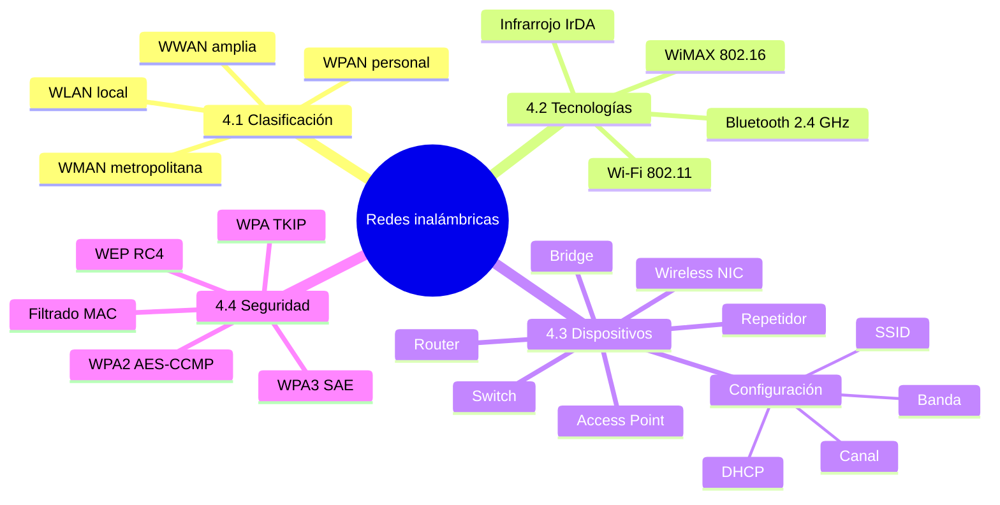

## Resumen de 1 minuto

> [!important] Si solo tuvieras 60 segundos
> | Tema | Relación clave |
> | --- | --- |
> | Alcance | **WPAN < WLAN < WMAN < WWAN** |
> | Bluetooth | WPAN · 2.4 GHz · sin línea de vista |
> | Infrarrojo | IrDA · **línea de vista** · no atraviesa paredes |
> | Wi-Fi | WLAN · **IEEE 802.11** |
> | WiMAX | WMAN · **IEEE 802.16** |
> | Access Point | Da acceso inalámbrico (**no** enruta necesariamente) |
> | Router | Enruta entre redes |
> | Repetidor | Extiende cobertura retransmitiendo |
> | SSID | **Nombre** de la red (no es contraseña) |
> | DHCP | Asigna IP automáticamente (no cifra) |
> | WEP | RC4 · obsoleto |
> | WPA | TKIP · RC4 · transición |
> | WPA2 | **AES-CCMP** · 802.11i |
> | WPA3 | **SAE** · el más reciente |
> | Filtrado MAC | **Control de acceso**, no cifrado |

---

# 4.1 Clasificación de las redes inalámbricas

Una red inalámbrica conecta dispositivos **sin cable como medio principal**, usando ondas electromagnéticas (radiofrecuencia o infrarrojo).

| Ventajas | Desventajas |
| --- | --- |
| Movilidad | Interferencias |
| Flexibilidad | Alcance limitado por obstáculos y ambiente |
| Instalación generalmente más sencilla | Riesgos de seguridad si se configura mal |

## Clasificación por cobertura

| Sigla | Nombre | Cobertura | Ejemplo | Uso |
| --- | --- | --- | --- | --- |
| **WPAN** | Personal | Pocos metros | Bluetooth | Dispositivos personales |
| **WLAN** | Local | Casa, oficina, edificio | Wi-Fi | Hogares y oficinas |
| **WMAN** | Metropolitana | Ciudad | WiMAX | Interconexión urbana |
| **WWAN** | Amplia (*Wide*) | Región o país | 4G / 5G | Telecomunicaciones |

> [!important] Orden de menor a mayor cobertura
> **WPAN → WLAN → WMAN → WWAN**
> Los alcances son orientativos; dependen de tecnología, potencia, obstáculos y condiciones.

> [!tip] Truco: la letra del medio
> **P**ersonal · **L**ocal · **M**etropolitana · **W**ide (amplia)

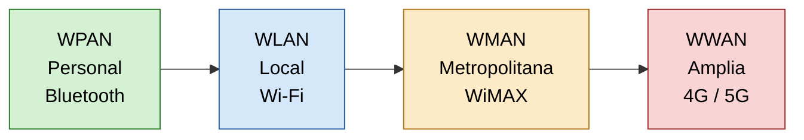

### Detalle de cada tipo

**WPAN** — dispositivos cercanos a una persona.
- Corto alcance, bajo consumo. No cubre edificios completos.
- Ejemplos: audífonos, teclado/mouse, smartwatch.
- Tecnologías: **Bluetooth** e **infrarrojo**.

**WLAN** — área pequeña: casa, escuela, oficina.
- Usa uno o varios **puntos de acceso**. Comparte Internet, archivos e impresoras.
- Tecnología: **Wi-Fi (IEEE 802.11)**.

**WMAN** — conecta instalaciones distribuidas en una ciudad.
- Mayor alcance que una WLAN; puede usar infraestructura de proveedores.
- Tecnología: **WiMAX (IEEE 802.16)**.

**WWAN** — grandes distancias; permite movilidad entre zonas geográficas.
- Redes celulares **4G LTE / 5G** y enlaces de radio.

> [!question]- Autoevaluación: ¿qué tipo de red es? (clic para ver)
> - Smartwatch ↔ celular → **WPAN**
> - Wi-Fi de un laboratorio → **WLAN**
> - Edificios de una universidad en distintas zonas de la ciudad → **WMAN**
> - Datos móviles 5G viajando entre ciudades → **WWAN**

---

# 4.2 Estándares y protocolos

Debes poder decir, para cada tecnología: **qué medio usa, en qué frecuencia trabaja, qué alcance tiene, qué estándar la define y para qué sirve**.

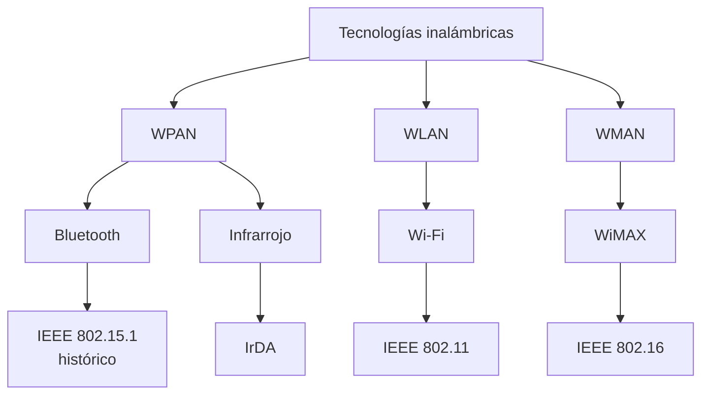

## Bluetooth

Comunicación inalámbrica entre dispositivos **cercanos**, sin cables y sin necesidad de un punto de acceso Wi-Fi.

- Banda de **2.4 GHz**, radio.
- Corto alcance y **bajo consumo** (sobre todo Bluetooth LE).
- Transmite **voz y datos**.
- Usa **saltos de frecuencia** (*Frequency Hopping*) para reducir interferencias.
- **No** requiere línea de vista directa.
- Estándar histórico **IEEE 802.15.1**; hoy lo mantiene Bluetooth SIG.
- Dispositivos: audífonos, bocinas, teclados, mouse, smartwatch, controles de videojuegos.

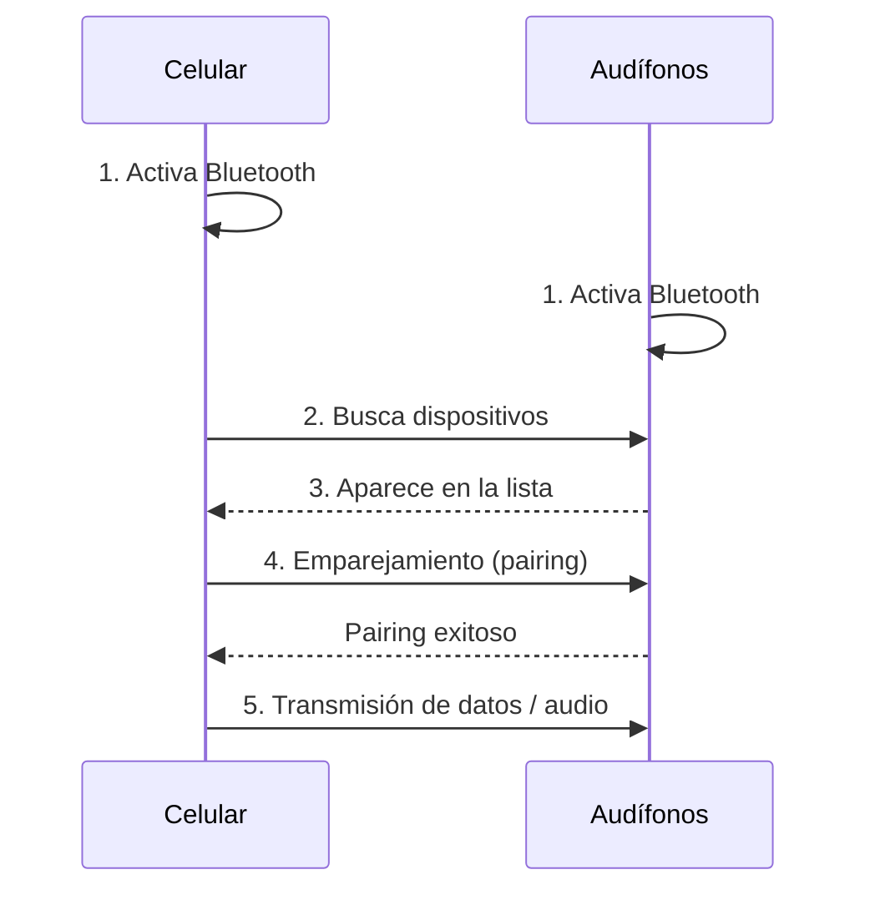

| Concepto | Significado |
| --- | --- |
| **Pairing** | Emparejamiento entre dispositivos |
| **Bluetooth Classic** | Comunicación continua (audio, datos) |
| **Bluetooth LE** | Bajo consumo de energía |
| **Frequency Hopping** | Cambiar de frecuencia durante la transmisión |
| **Piconet** | Red pequeña de dispositivos Bluetooth |

## Infrarrojo (IR)

Transmite con **luz infrarroja**, no con ondas de radio.

- Alcance muy reducido.
- Generalmente necesita **línea de vista directa**.
- **No atraviesa** paredes ni objetos opacos.
- Estándar/familia: **IrDA** (*Infrared Data Association*).
- Ejemplo: control remoto → sensor del televisor.

### Bluetooth vs. infrarrojo

| Característica | Bluetooth | Infrarrojo |
| --- | --- | --- |
| Medio | Ondas de radio | Luz infrarroja |
| Frecuencia | 2.4 GHz | Radiación óptica |
| Línea de vista | No es indispensable | Generalmente **sí** |
| Paredes | Puede atravesar algunas | No atraviesa opacas |
| Alcance | Corto | Muy corto |
| Ejemplo | Audífonos | Control remoto |

> [!warning] Trampa
> «Bluetooth necesita apuntar directamente al dispositivo» → **FALSO**. Eso es del infrarrojo dirigido.

## Wi-Fi

Conecta dispositivos a una **red local** y permite compartir Internet, archivos e impresoras.

- Familia **IEEE 802.11** → clasificación **WLAN**.
- Bandas: **2.4 GHz, 5 GHz** y, en generaciones recientes, **6 GHz**.
- Usa puntos de acceso o routers inalámbricos.
- Requiere mecanismos de seguridad.

### Generaciones

| Estándar | Nombre comercial | Frecuencia habitual |
| --- | --- | --- |
| 802.11b | Wi-Fi 1 | 2.4 GHz |
| 802.11a | Wi-Fi 2 | **5 GHz** |
| 802.11g | Wi-Fi 3 | 2.4 GHz |
| 802.11n | Wi-Fi 4 | 2.4 y 5 GHz |
| 802.11ac | Wi-Fi 5 | **5 GHz** |
| 802.11ax | Wi-Fi 6 / 6E | 2.4, 5 y 6 GHz (según versión) |
| 802.11be | Wi-Fi 7 | 2.4, 5 y 6 GHz |

> [!tip] Lo que sí conviene saber
> No memorices velocidades. Memoriza: **802.11 = Wi-Fi**, **a y ac = solo 5 GHz**, **b y g = solo 2.4 GHz**, **n = ambas**.

### Bandas de frecuencia

| Característica | 2.4 GHz | 5 GHz | 6 GHz |
| --- | --- | --- | --- |
| Alcance | **Mayor** | Menor | Menor |
| Interferencias | **Más frecuentes** | Generalmente menos | Generalmente menos |
| Velocidad potencial | Menor | **Mayor** | **Mayor** |
| Penetración de obstáculos | **Mejor** | Menor | Menor |
| Compatibilidad | Muy amplia | Amplia | Solo equipos compatibles |

> [!important] Regla mnemotécnica
> **Más frecuencia = más velocidad, pero menos alcance.**

### Conceptos de Wi-Fi

| Concepto | Significado |
| --- | --- |
| **SSID** | Nombre de la red |
| **BSSID** | Identificador MAC del punto de acceso |
| **Canal** | Porción del espectro usada para transmitir |
| **Access Point** | Permite conectar clientes inalámbricos |
| **Roaming** | Cambiar de AP sin perder (necesariamente) la conexión |
| **Hotspot** | Punto que da acceso a una red inalámbrica |

## WiMAX

*Worldwide Interoperability for Microwave Access*. Acceso inalámbrico de **banda ancha** a distancias mayores que una WLAN.

- Estándar **IEEE 802.16** → clasificación **WMAN**.
- Cubre áreas metropolitanas; usuarios a varios kilómetros.
- Usa **estaciones base**; acceso fijo y móvil.

| Componente | Función |
| --- | --- |
| Estación base | Da conectividad y administra a los suscriptores |
| Estación suscriptora | Equipo del usuario |
| Antena | Transmite y recibe señales |

### Wi-Fi vs. WiMAX

| Característica | Wi-Fi | WiMAX |
| --- | --- | --- |
| Estándar | IEEE **802.11** | IEEE **802.16** |
| Clasificación | WLAN | WMAN |
| Cobertura | Local | Metropolitana |
| Uso | Casas y oficinas | Banda ancha a mayor distancia |
| Infraestructura | Puntos de acceso | Estaciones base |

## Comparación general

| Tecnología | Clasificación | Estándar | Característica clave |
| --- | --- | --- | --- |
| Bluetooth | WPAN | 802.15.1 (histórico) / Bluetooth SIG | Corto alcance, bajo consumo |
| Infrarrojo | WPAN | IrDA | Necesita línea de vista |
| Wi-Fi | WLAN | 802.11 | Redes locales |
| WiMAX | WMAN | 802.16 | Banda ancha metropolitana |

### ¿Qué tecnología es? (árbol de decisión)

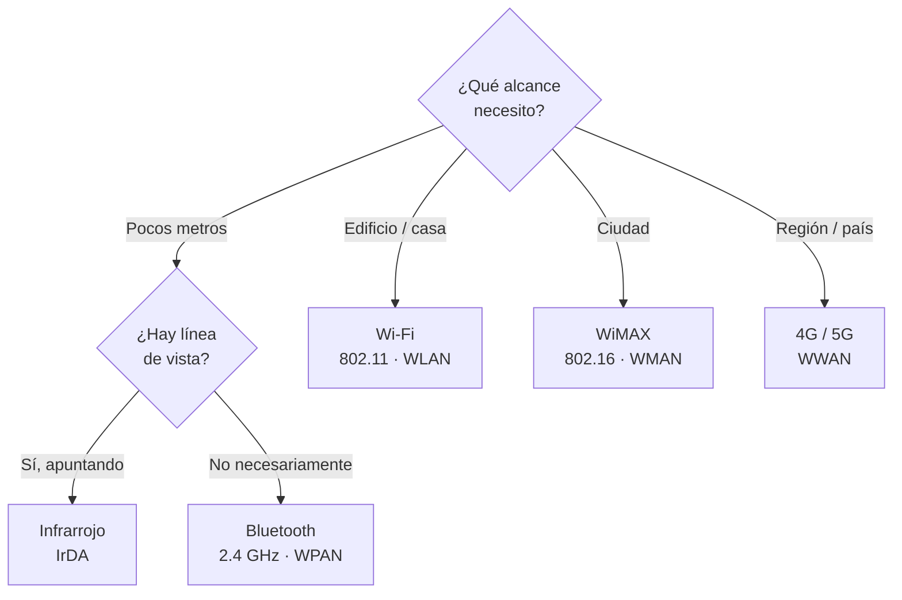

> [!question]- Autoevaluación (clic para ver)
> 1. ¿Qué estándar usa Wi-Fi? → **IEEE 802.11**
> 2. ¿Y WiMAX? → **IEEE 802.16**
> 3. ¿Qué tecnología personal requiere línea de vista? → **Infrarrojo**
> 4. ¿Qué banda Wi-Fi tiene mayor alcance? → **2.4 GHz**
> 5. ¿Qué trampa común hay con 802.11n? → Que se diga que opera *solo* en una banda: opera en **2.4 y 5 GHz**.

---

# 4.3 Dispositivos y configuración

## Dispositivos de una red inalámbrica

| Dispositivo | Función principal | Palabra clave |
| --- | --- | --- |
| **Access Point (AP)** | Conecta equipos inalámbricos a una red cableada | Acceso Wi-Fi |
| **Router inalámbrico** | Comunica redes distintas; suele integrar AP, DHCP y firewall | Enrutamiento |
| **Repetidor** | Recibe y retransmite la señal para extender cobertura | Extender |
| **Wireless NIC** | Adaptador que permite a un equipo conectarse a Wi-Fi | Adaptador |
| **Bridge inalámbrico** | Une dos segmentos de red mediante un enlace inalámbrico | Puente |
| **Switch** | Interconecta equipos de una LAN (generalmente cableada) | Conmutación |

### Access Point
- Da conectividad Wi-Fi y administra las conexiones de los clientes.
- Varios AP amplían la cobertura (ej.: una escuela con Wi-Fi en cada salón).
- ⚠️ **No necesariamente enruta** como un router.

### Router inalámbrico
- Conecta la LAN con Internet y enruta paquetes entre redes.
- Suele integrar: **AP Wi-Fi + puertos Ethernet + DHCP + firewall**.

### Repetidor
- Amplía la cobertura y reduce zonas sin señal.
- Puede **reducir el rendimiento** disponible porque consume tiempo de aire al retransmitir.
- ⚠️ No aumenta la velocidad contratada con el proveedor de Internet.

### Wireless NIC
- Puede venir integrada en la placa base o instalarse por **USB o PCIe**.

### Bridge inalámbrico
- Interconecta LAN y transporta tráfico entre segmentos.
- Ejemplo: unir dos edificios sin tender cable entre ellos.

### Switch
- Conecta computadoras, impresoras y Access Points.
- Transporta **tramas Ethernet** y **aprende direcciones MAC**.
- Separa **dominios de colisión por puerto**.
- ⚠️ Un switch de capa 2 **no sustituye a un router** para comunicar redes IP distintas.

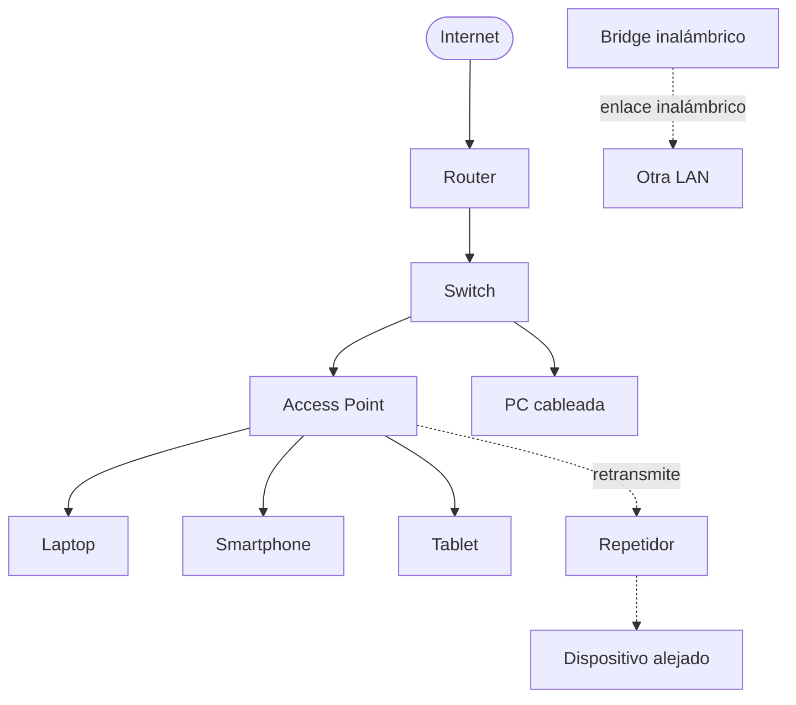

### ¿Qué dispositivo necesito? (árbol de decisión)

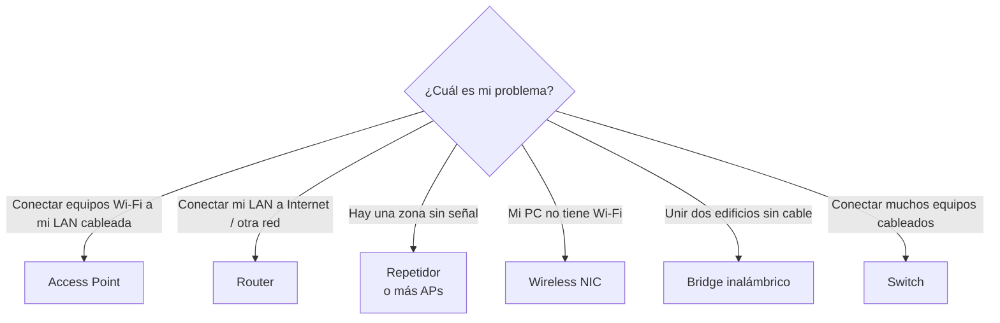

> [!question]- Autoevaluación (clic para ver)
> - Un AP, ¿hace siempre enrutamiento? → **No.**
> - ¿Qué dispositivo lleva tráfico entre dos edificios por aire? → **Bridge inalámbrico.**
> - ¿Qué dispositivo aprende MAC y separa dominios de colisión por puerto? → **Switch.**

---

## Configuración de una red inalámbrica

### SSID (*Service Set Identifier*)
- **Nombre** de la red (ej.: `Laboratorio_Redes`). Puede ser visible u oculto.
- **No** es contraseña. Varios AP pueden anunciar el mismo SSID.

### Canal
- División de la banda de frecuencias que organiza las transmisiones.
- Canales superpuestos generan interferencia.
- En **2.4 GHz** (20 MHz), los canales **no superpuestos** clásicos son **1, 6 y 11**.

### Banda de frecuencia
- **2.4 GHz**, **5 GHz** y **6 GHz**.

### Contraseña inalámbrica
- Debe ser difícil de adivinar, larga, combinar tipos de caracteres y **no ser la predeterminada**.

### DHCP
Asigna automáticamente **dirección IP, máscara, puerta de enlace y servidores DNS**.

- **No** es exclusivo de redes inalámbricas (también cableadas).
- **No** cifra información.
- Usa **UDP 67 (servidor)** y **UDP 68 (cliente)**.
- El mensaje *Discover* se envía como **broadcast**.
- Un **DHCP relay** permite que clientes de una VLAN obtengan IP de un servidor ubicado en otra red.

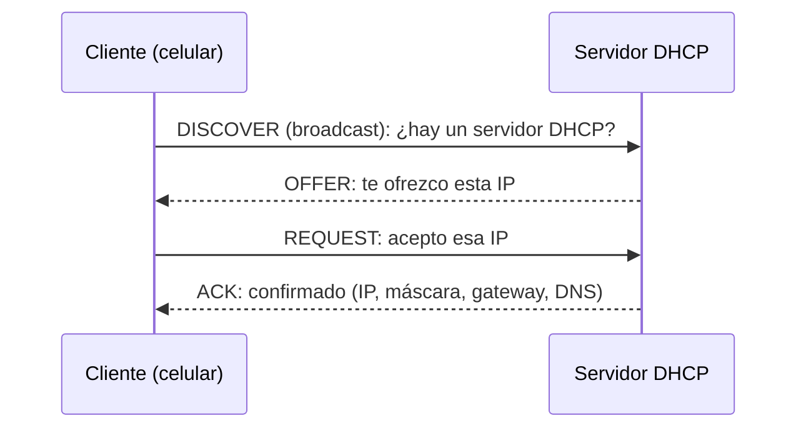

> [!tip] Memotecnia: **D-O-R-A**
> **D**iscover → **O**ffer → **R**equest → **A**cknowledge

### Pasos para configurar una red Wi-Fi

| Paso | Configuración | Propósito |
| --- | --- | --- |
| 1 | Acceder al router | Entrar al panel administrativo |
| 2 | Configurar SSID | Nombre de la red |
| 3 | Seleccionar banda | 2.4, 5 o 6 GHz |
| 4 | Seleccionar canal | Organizar las transmisiones |
| 5 | Configurar seguridad | WPA2 o WPA3 |
| 6 | Establecer contraseña | Controlar el acceso |
| 7 | Configurar DHCP | Asignar IP automáticamente |
| 8 | Guardar cambios | Aplicar configuración |
| 9 | Probar conexión | Verificar conectividad |

### Proceso de conexión de un cliente

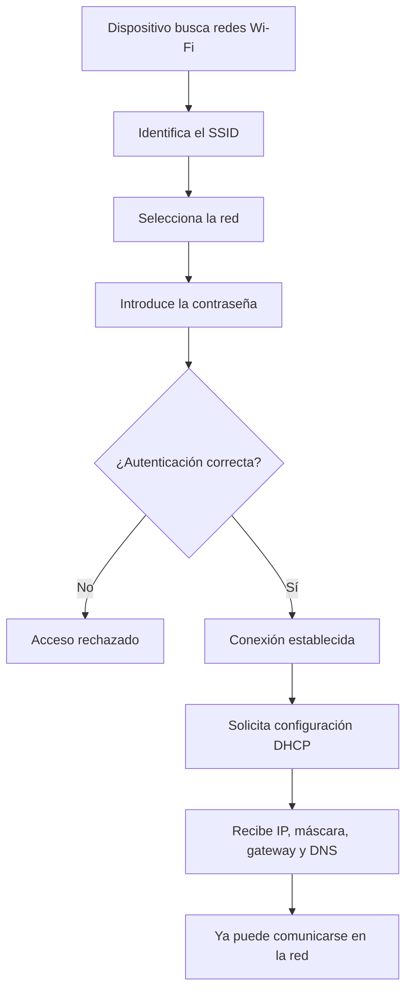

> [!warning] Trampas de esta sección
> - SSID = **nombre**, no contraseña.
> - DHCP **asigna** parámetros IP; no cifra.
> - AP = acceso inalámbrico; **no necesariamente** enruta.
> - Repetidor retransmite señal; **no** aumenta la velocidad contratada.
> - El canal organiza la transmisión; **no** es una dirección IP.

---

# 4.4 Seguridad inalámbrica

Las ondas pueden llegar fuera del espacio donde está el router, así que hay que **proteger la información y controlar quién se conecta**.

| Objetivo | Descripción |
| --- | --- |
| **Confidencialidad** | Que personas no autorizadas no lean la información |
| **Integridad** | Que no haya modificaciones no autorizadas |
| **Autenticación** | Verificar la identidad de quien se conecta |
| **Control de acceso** | Permitir o restringir conexiones de dispositivos |

> [!warning] Aclaración de nomenclatura del temario
> En el temario aparecen `WAP` y `WEP2`. En la nomenclatura habitual de Wi-Fi las tecnologías a reconocer son **WEP, WPA, WPA2 y WPA3**. Es probable que sean errores de escritura de `WPA` y `WPA2`. Si te aparecen en el examen, **lee el contexto**.

## Línea del tiempo

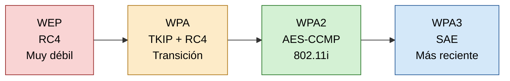

## WEP — *Wired Equivalent Privacy*

> [!danger] Obsoleto e inseguro. No usar.

- Pretendía dar una privacidad **equivalente a la de una red cableada**.
- Cifrado **RC4**; claves de **64 o 128 bits** en implementaciones clásicas.
- Vulnerabilidades graves (manejo de vectores de inicialización y diseño criptográfico).

## WAP (¡ojo con el contexto!)

| Significado | Qué es |
| --- | --- |
| *Wireless Access Point* | Punto de acceso inalámbrico |
| *Wireless Application Protocol* | Protocolo antiguo para acceso a servicios web desde móviles limitados |
| Error de escritura | Probablemente quiere decir **WPA** |

> [!warning] WAP **no** es un algoritmo de cifrado equivalente a WEP o WPA.

## WPA — *Wi-Fi Protected Access*

- Se creó para **corregir las debilidades de WEP**.
- **TKIP** (*Temporal Key Integrity Protocol*): administra claves temporales y da integridad de datos.
- Sigue usando **RC4**.
- Autenticación por **PSK** o mecanismos empresariales. Hoy se considera **heredado**.

> [!important] Memoriza: **WPA1 → TKIP → RC4**

## WPA-PSK — *Pre-Shared Key*

Método de **autenticación**: todos los dispositivos conocen una **clave previamente compartida**.

- Común en casas y oficinas pequeñas; no necesita servidor de autenticación empresarial.
- ⚠️ **PSK no es un algoritmo de cifrado** ni un protocolo de asignación de IP.
- Existe también **WPA2-PSK** (WPA2 con clave compartida).

## WPA2 — *Wi-Fi Protected Access 2*

> [!success] Más seguro que WEP y WPA1

- Basado en **IEEE 802.11i**.
- Usa **AES-CCMP**.
  - **AES** = *Advanced Encryption Standard* (algoritmo de cifrado).
  - **CCMP** = *Counter Mode with CBC-MAC Protocol*: usa AES para dar **confidencialidad e integridad**.
- Autenticación por **PSK** (personal) o **802.1X/EAP** (empresarial).

> [!important] Memoriza: **WPA2 → AES → CCMP → 802.11i**

## WPA3

- Generación más reciente de las cuatro.
- En modo personal usa **SAE** (*Simultaneous Authentication of Equals*) en lugar del PSK tradicional.

## ¿Y WEP2?

**No** es el nombre normalizado de una generación equivalente a WPA2. Probablemente es un error por WPA2.

## Comparación WEP · WPA · WPA2

| Característica | WEP | WPA | WPA2 |
| --- | --- | --- | --- |
| Antigüedad | Más antiguo | Posterior a WEP | Posterior a WPA |
| Cifrado | RC4 | RC4 | **AES** |
| Protocolo de protección | WEP | **TKIP** | **CCMP** |
| Seguridad | Muy débil | Mejor que WEP, hoy obsoleta | Más robusta |
| Estándar | 802.11 original | Previo a 802.11i | **802.11i** |
| Recomendación | No usar | Evitar | Preferible a WPA1 |

## Filtrado de direcciones MAC

Mecanismo de **control de acceso**: acepta o rechaza dispositivos según su **MAC** (identificador de capa 2 del modelo OSI, ej. `00:1A:2B:3C:4D:5E`).

| Lista | Qué hace |
| --- | --- |
| **Whitelist** (blanca) | Solo se conectan las MAC autorizadas |
| **Blacklist** (negra) | Se bloquean las MAC indicadas |

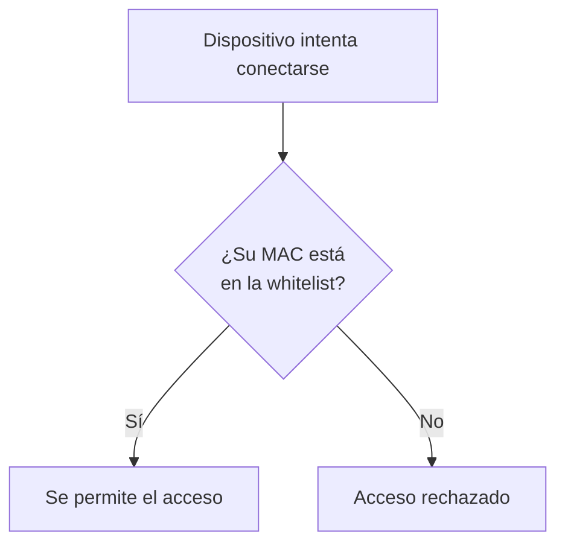

| Ventajas | Desventajas |
| --- | --- |
| Controla qué dispositivos entran | Hay que administrar las MAC |
| Restringe accesos no deseados | **No cifra** la información |
| Listas permitidas o bloqueadas | No sustituye a WPA2/WPA3 |
| | Evadible con **MAC spoofing** |

> [!danger] MUY IMPORTANTE
> Filtrado MAC = **control de acceso**, NO cifrado.

> [!question]- Autoevaluación (clic para ver)
> - ¿Qué cifrado usa WEP? → **RC4**
> - ¿Qué protocolo acompaña a WPA1? → **TKIP**
> - ¿Qué usa WPA2? → **AES-CCMP** (802.11i)
> - ¿Qué reemplaza al PSK en WPA3 personal? → **SAE**
> - ¿Por qué el filtrado MAC es débil? → Porque la MAC puede **falsificarse** y no cifra nada.

---

# Trampas de examen

Son afirmaciones con **una palabra cambiada** para volverlas falsas.

| # | Afirmación falsa | Corrección |
| --- | --- | --- |
| 1 | «Bluetooth necesita línea de vista directa» | Falso: eso es el infrarrojo |
| 2 | «Wi-Fi utiliza IEEE 802.16» | Utiliza **802.11** |
| 3 | «WiMAX utiliza IEEE 802.11» | Utiliza **802.16** |
| 4 | «WPAN cubre ciudades completas» | Es personal, de corto alcance |
| 5 | «Wi-Fi es una tecnología metropolitana» | Es **WLAN** |
| 6 | «Un AP necesariamente realiza enrutamiento» | Su función es dar acceso inalámbrico |
| 7 | «DHCP cifra la información» | Asigna parámetros de red |
| 8 | «SSID es la contraseña del Wi-Fi» | Es el **nombre** de la red |
| 9 | «WEP es el protocolo más moderno» | Es antiguo e inseguro |
| 10 | «WPA-PSK es un protocolo de asignación de IP» | Autentica con clave compartida |
| 11 | «El filtrado MAC cifra los datos» | Controla qué dispositivos acceden |
| 12 | «WPA2 usa RC4 como mecanismo principal» | Usa **AES-CCMP** |

---

# Cómo preguntan los exámenes

Patrones observados en tus dos exámenes anteriores. Aplícalos aquí:

> [!abstract] Patrones del examen
> 1. **Varias respuestas correctas.** Muchas preguntas dicen «subraya *la o las* respuestas correctas». Hay que marcar **todas** las correctas; si falta una o sobra una, probablemente se pierde el punto.
> 2. **Palabras absolutas = alerta.** Términos como **«únicamente»**, **«exclusivamente»**, **«siempre»**, **«solo»** suelen hacer falsa una afirmación que de otro modo sería cierta (ej.: «Wi-Fi opera *únicamente* en 2.4 GHz»).
> 3. **Afirmación parcialmente falsa.** Empieza bien y termina mal. Lee **hasta el final** antes de marcar.
> 4. **Función principal.** «¿Cuál es la función de X?» → quédate con la palabra clave (AP = acceso, router = enrutar, repetidor = extender).
> 5. **Comparaciones.** «¿Qué diferencia a X de Y?» → piensa en estándar, alcance, medio y clasificación.
> 6. **Cifrado vs. autenticación vs. control de acceso.** Es la confusión favorita: **AES/RC4 = cifrado**, **PSK/802.1X = autenticación**, **filtrado MAC = control de acceso**.
> 7. **Orden y jerarquía.** Alcance (WPAN→WWAN) y evolución (WEP→WPA3).

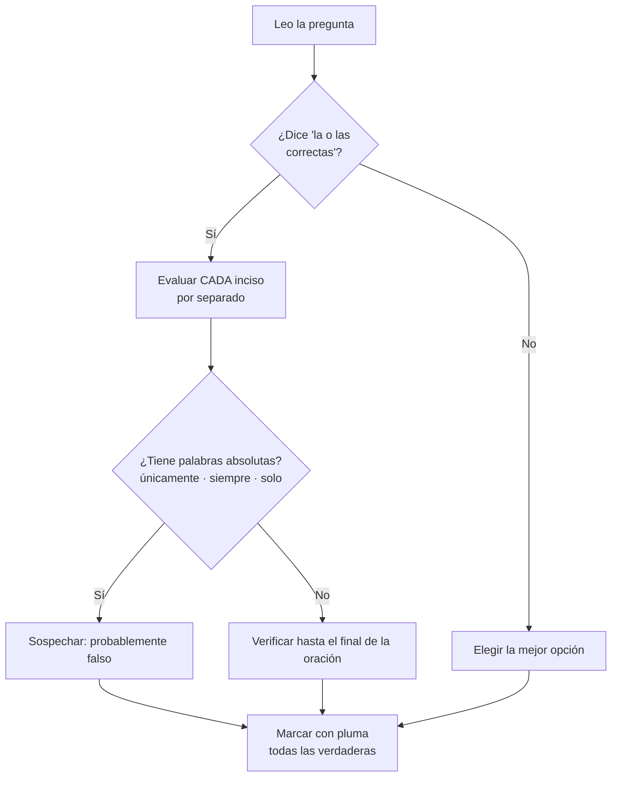

---

# Banco de preguntas

> [!info] Instrucciones (como en tus exámenes)
> Subraya **la o las** respuestas correctas. Contesta con pluma, sin tachones. Para acertar debes marcar **todos** los incisos correctos y **ninguno** incorrecto.
>
> - 🔘 = **una** respuesta correcta
> - ☑️ = **una o varias** respuestas correctas
>
> Las respuestas están plegadas: haz clic en **Ver respuesta** después de contestar. Califícate de forma estricta.

## Bloque A. Clasificación y tecnologías

**1.** 🔘 ¿Qué tipo de red inalámbrica está diseñada para cubrir una zona metropolitana?
- a) WPAN
- b) WLAN
- c) WMAN
- d) WWAN

> [!success]- Ver respuesta
> **c) WMAN.** WPAN es personal, WLAN es local y WWAN cubre regiones o países.

**2.**  Respecto a **Bluetooth**, ¿qué afirmaciones son correctas?
- a) Trabaja en la banda de 2.4 GHz.
- b) Requiere línea de vista directa entre los dispositivos.
- c) Se clasifica como WPAN.
- d) Utiliza saltos de frecuencia para reducir interferencias.
- e) Se asocia con el estándar IEEE 802.16.

> [!success]- Ver respuesta
> **a, c, d.**
> - b) Falso: la línea de vista es característica del infrarrojo.
> - e) Falso: 802.16 es WiMAX; Bluetooth se asocia con 802.15.1.

**3.**  Respecto a **Wi-Fi**, ¿qué afirmaciones son correctas?
- a) Pertenece a la familia de estándares IEEE 802.11.
- b) Se clasifica habitualmente como WLAN.
- c) Opera únicamente en la banda de 2.4 GHz.
- d) Según la generación, puede operar en 2.4, 5 y 6 GHz.
- e) Se clasifica como WMAN.

> [!success]- Ver respuesta
> **a, b, d.**
> - c) Falso: «únicamente» es la palabra trampa; también usa 5 y 6 GHz.
> - e) Falso: WiMAX es la tecnología WMAN.

**4.** Respecto al **infrarrojo**, ¿qué afirmaciones son correctas?
- a) Transmite información mediante luz infrarroja.
- b) Puede atravesar paredes opacas con facilidad.
- c) Generalmente necesita línea de vista entre emisor y receptor.
- d) Se relaciona con las especificaciones IrDA.
- e) Utiliza saltos de frecuencia en 2.4 GHz.

> [!success]- Ver respuesta
> **a, c, d.** b) y e) corresponden a lo opuesto o a Bluetooth.

**5.** ¿Qué estándar IEEE se asocia con **WiMAX**?
- a) IEEE 802.3
- b) IEEE 802.11
- c) IEEE 802.15.1
- d) IEEE 802.16

> [!success]- Ver respuesta
> **d) IEEE 802.16.**

**6.**  Al comparar las bandas de **2.4 GHz** y **5 GHz** en Wi-Fi, ¿qué afirmaciones son correctas?
- a) 2.4 GHz suele tener mayor alcance.
- b) 2.4 GHz suele sufrir más interferencias.
- c) 5 GHz tiene mayor velocidad potencial.
- d) 5 GHz atraviesa obstáculos mejor que 2.4 GHz.
- e) 5 GHz siempre tiene mayor alcance que 2.4 GHz.

> [!success]- Ver respuesta
> **a, b, c.** d) y e) invierten la relación: a más frecuencia, más velocidad pero **menos** alcance y menos penetración.

**7.**  ¿Qué estándares 802.11 operan **exclusivamente** en la banda de 5 GHz?
- a) 802.11a
- b) 802.11b
- c) 802.11g
- d) 802.11ac
- e) 802.11n

> [!success]- Ver respuesta
> **a, d.** b) y c) usan 2.4 GHz; e) 802.11n opera en 2.4 **y** 5 GHz.

**8.**  ¿A qué estándar corresponde el nombre comercial **Wi-Fi 6**?
- a) 802.11n
- b) 802.11ac
- c) 802.11ax
- d) 802.11be

> [!success]- Ver respuesta
> **c) 802.11ax.** (n = Wi-Fi 4, ac = Wi-Fi 5, be = Wi-Fi 7).

**9.** Respecto a las **WWAN**, ¿qué afirmaciones son correctas?
- a) Pueden cubrir regiones y países.
- b) Las redes celulares 4G y 5G son ejemplos.
- c) Su tecnología tradicional es WiMAX.
- d) Utilizan infraestructura de telecomunicaciones.
- e) Tienen un alcance de pocos metros.

> [!success]- Ver respuesta
> **a, b, d.** c) WiMAX es la tecnología tradicional de WMAN; e) describe una WPAN.

## Bloque B. Dispositivos y configuración

**10.** ¿Qué dispositivo permite conectar equipos inalámbricos a una red cableada?
- a) Access Point
- b) Bridge
- c) Switch
- d) Wireless NIC

> [!success]- Ver respuesta
> **a) Access Point.**

**11.** ¿Qué funciones integra generalmente un **router inalámbrico**?
- a) Enrutamiento entre redes.
- b) Punto de acceso Wi-Fi.
- c) Servidor DHCP en muchos modelos.
- d) Únicamente retransmitir la señal de otro equipo.
- e) Funciones de seguridad y firewall.

> [!success]- Ver respuesta
> **a, b, c, e.** d) describe un repetidor, y «únicamente» delata la trampa.

**12.** Respecto a un **repetidor inalámbrico**, ¿qué afirmaciones son correctas?
- a) Amplía el área de cobertura.
- b) Retransmite la señal que recibe.
- c) Aumenta la velocidad de Internet contratada con el proveedor.
- d) Puede reducir el rendimiento disponible por el tiempo de aire que usa.
- e) Asigna direcciones IP a los clientes.

> [!success]- Ver respuesta
> **a, b, d.** c) y e) son falsas.

**13.**  Respecto a **DHCP**, ¿qué afirmaciones son correctas?
- a) Asigna direcciones IP automáticamente.
- b) Puede entregar máscara de subred, puerta de enlace y servidores DNS.
- c) Cifra la información transmitida en la red.
- d) Es un protocolo exclusivo de redes inalámbricas.
- e) El mensaje Discover se envía como broadcast.

> [!success]- Ver respuesta
> **a, b, e.** c) DHCP no cifra; d) también funciona en redes cableadas.

**14.**  ¿Cuál es el orden correcto del proceso DHCP?
- a) Offer → Discover → Request → Acknowledge
- b) Discover → Offer → Request → Acknowledge
- c) Request → Discover → Offer → Acknowledge
- d) Discover → Request → Offer → Acknowledge

> [!success]- Ver respuesta
> **b)** D-O-R-A.

**15.**  Respecto a un **switch**, ¿qué afirmaciones son correctas?
- a) Aprende direcciones MAC.
- b) Separa dominios de colisión por puerto.
- c) Enruta paquetes entre redes IP diferentes como función principal.
- d) Transporta tramas Ethernet.
- e) Sustituye completamente al router.

> [!success]- Ver respuesta
> **a, b, d.** c) y e) corresponden al router.

**16.**  En 2.4 GHz, los canales **1, 6 y 11** son importantes porque:
- a) Son los únicos que existen en 5 GHz.
- b) Son canales clásicos no superpuestos en 2.4 GHz.
- c) Son puertos usados por DHCP.
- d) Son identificadores de SSID.

> [!success]- Ver respuesta
> **b).**

**17.** + ¿Cuál es el mejor ejemplo del uso de un **bridge inalámbrico**?
- a) Dar Wi-Fi a una sala de juntas.
- b) Interconectar dos edificios mediante un enlace inalámbrico.
- c) Asignar IP automáticamente.
- d) Cifrar el tráfico con AES.

> [!success]- Ver respuesta
> **b).**

**18.**  Respecto al **SSID**, ¿qué afirmaciones son correctas?
- a) Es el nombre que identifica una red inalámbrica.
- b) Es la contraseña de acceso a la red.
- c) Puede ocultarse.
- d) Varios puntos de acceso pueden anunciar el mismo SSID.
- e) Es una dirección IP.

> [!success]- Ver respuesta
> **a, c, d.**

**19.**  ¿Cuál secuencia de configuración es la más lógica?
- a) Seguridad → SSID → canal → DHCP
- b) SSID → banda → canal → seguridad → contraseña → DHCP
- c) DHCP → contraseña → SSID → banda
- d) Contraseña → DHCP → canal → SSID

> [!success]- Ver respuesta
> **b)** Primero identificas la red y el medio (SSID, banda, canal), luego proteges (seguridad, contraseña) y finalmente asignas IP (DHCP).

## Bloque C. Seguridad

**20.** ¿Qué algoritmo de cifrado utiliza **WEP**?
- a) AES
- b) RC4
- c) SAE
- d) CCMP

> [!success]- Ver respuesta
> **b) RC4.**

**21.**  Respecto a **WPA2**, ¿qué afirmaciones son correctas?
- a) Se basa en IEEE 802.11i.
- b) Utiliza AES-CCMP.
- c) Utiliza RC4 como mecanismo principal.
- d) Puede autenticar con PSK o con 802.1X/EAP.
- e) Ofrece mejor protección que WEP y WPA1.

> [!success]- Ver respuesta
> **a, b, d, e.** c) Falso: RC4 es de WEP/WPA1.

**22.**  ¿Qué mecanismo sustituye al PSK tradicional en **WPA3-Personal**?
- a) TKIP
- b) SAE
- c) RC4
- d) WEP

> [!success]- Ver respuesta
> **b) SAE.**

**23.**  Respecto a **WPA (WPA1)**, ¿qué afirmaciones son correctas?
- a) Utiliza TKIP.
- b) Emplea RC4.
- c) Su mecanismo principal es AES-CCMP.
- d) Fue una mejora respecto a WEP.
- e) Hoy es la opción más recomendada.

> [!success]- Ver respuesta
> **a, b, d.** c) es WPA2; e) hoy se considera heredado.

**24.**  Respecto a **PSK**, ¿qué afirmaciones son correctas?
- a) Es una clave previamente compartida.
- b) Es un algoritmo de cifrado.
- c) Es común en redes domésticas y pequeñas oficinas.
- d) Existe también la modalidad WPA2-PSK.
- e) Asigna direcciones IP automáticamente.

> [!success]- Ver respuesta
> **a, c, d.** b) PSK autentica, no es un algoritmo de cifrado.

**25.**  Respecto al **filtrado de direcciones MAC**, ¿qué afirmaciones son correctas?
- a) Es un mecanismo de control de acceso.
- b) Cifra los datos transmitidos.
- c) Puede evadirse falsificando la MAC.
- d) Sustituye a WPA2 o WPA3.
- e) Puede funcionar con listas blancas o negras.

> [!success]- Ver respuesta
> **a, c, e.**

**26.**  ¿Qué objetivo de seguridad consiste en **verificar la identidad** de quien se conecta?
- a) Confidencialidad
- b) Integridad
- c) Autenticación
- d) Disponibilidad física

> [!success]- Ver respuesta
> **c) Autenticación.**

**27.**  ¿Cuál es el orden de **más antiguo a más reciente**?
- a) WPA → WEP → WPA2 → WPA3
- b) WEP → WPA → WPA2 → WPA3
- c) WPA2 → WPA → WEP → WPA3
- d) WEP → WPA2 → WPA → WPA3

> [!success]- Ver respuesta
> **b).**

**28.**  ¿Qué afirmaciones son **FALSAS**?
- a) El SSID es la contraseña del Wi-Fi.
- b) WPA2 utiliza AES-CCMP.
- c) DHCP cifra la información de la red.
- d) WiMAX se asocia con IEEE 802.16.
- e) Bluetooth necesita línea de vista directa.

> [!success]- Ver respuesta
> **a, c, e.** Cuidado: la pregunta pide las **falsas**.

**29.**  Respecto al término **WAP**, ¿qué afirmaciones son correctas?
- a) Puede significar *Wireless Access Point*.
- b) Puede significar *Wireless Application Protocol*.
- c) Es un algoritmo de cifrado equivalente a WEP.
- d) En el temario puede ser un error de escritura de WPA.
- e) Siempre significa WPA2.

> [!success]- Ver respuesta
> **a, b, d.**

## Bloque D. Casos prácticos

**30.** Una escuela quiere Wi-Fi en 10 salones conectados a una LAN cableada. ¿Qué solución es la más adecuada?
- a) Un solo repetidor.
- b) Varios Access Points conectados a un switch.
- c) Un bridge inalámbrico entre salones.
- d) Una antena WiMAX por salón.

> [!success]- Ver respuesta
> **b).**

**31.**  En una casa, una recámara lejana tiene señal débil. ¿Qué medidas ayudan?
- a) Colocar un repetidor en una zona intermedia.
- b) Instalar un Access Point adicional conectado por cable.
- c) Ocultar el SSID.
- d) Activar el filtrado MAC.
- e) Elegir un canal con menos interferencia.

> [!success]- Ver respuesta
> **a, b, e.** Ocultar el SSID y filtrar MAC son medidas de seguridad, no de cobertura.

**32.**  ¿Qué configuraciones son adecuadas para una red doméstica segura?
- a) Utilizar WPA2 o WPA3.
- b) Dejar la contraseña predeterminada.
- c) Usar una contraseña larga que combine caracteres.
- d) Usar WEP por compatibilidad.
- e) Usar filtrado MAC solo como complemento.

> [!success]- Ver respuesta
> **a, c, e.**

**33.** Una universidad necesita conectar edificios en diferentes zonas de una ciudad con banda ancha inalámbrica. ¿Qué clasificación y tecnología encajan mejor?
- a) WPAN · Bluetooth
- b) WLAN · Wi-Fi doméstico
- c) WMAN · WiMAX
- d) WPAN · Infrarrojo

> [!success]- Ver respuesta
> **c) WMAN · WiMAX (802.16).**

> [!tip] Autocalificación
> Cuenta como correcta **solo** la pregunta en la que marcaste todos los incisos correctos y ninguno incorrecto. Si fallas muchas del bloque C, repasa la [[#Comparación WEP · WPA · WPA2]] y las [[#Trampas de examen]].

---

¿Qué significa WPAN?::Wireless Personal Area Network
¿Qué significa WMAN?::Wireless Metropolitan Area Network
Orden de menor a mayor cobertura::WPAN → WLAN → WMAN → WWAN
Estándar de Wi-Fi::IEEE 802.11
Estándar de WiMAX::IEEE 802.16
Estándar histórico de Bluetooth::IEEE 802.15.1
Banda de Bluetooth::2.4 GHz
Tecnología que necesita línea de vista::Infrarrojo (IrDA)
Banda con mayor alcance en Wi-Fi::2.4 GHz
Banda con mayor velocidad potencial::5 GHz y 6 GHz
Estándares 802.11 solo en 5 GHz::802.11a y 802.11ac
Wi-Fi 4 / 5 / 6 / 7::802.11n / ac / ax / be
Canales no superpuestos en 2.4 GHz::1, 6 y 11
¿Qué es el SSID?::El nombre de la red inalámbrica
¿Qué hace un Access Point?::Da acceso inalámbrico a una red cableada
¿Qué hace un repetidor?::Retransmite la señal para extender la cobertura
¿Qué hace un bridge inalámbrico?::Une dos segmentos de red mediante un enlace inalámbrico
¿Qué asigna DHCP?::IP, máscara, puerta de enlace y DNS
Puertos de DHCP::UDP 67 (servidor) y UDP 68 (cliente)
Fases de DHCP::Discover, Offer, Request, Acknowledge
Cifrado de WEP::RC4
Protocolo y cifrado de WPA::TKIP y RC4
Cifrado de WPA2::AES-CCMP (IEEE 802.11i)
Mecanismo de WPA3-Personal::SAE
¿Qué es PSK?::Clave previamente compartida (autenticación)
¿Qué es el filtrado MAC?::Control de acceso, no cifrado
¿Cómo se evade el filtrado MAC?::Falsificando la MAC (MAC spoofing)

---

