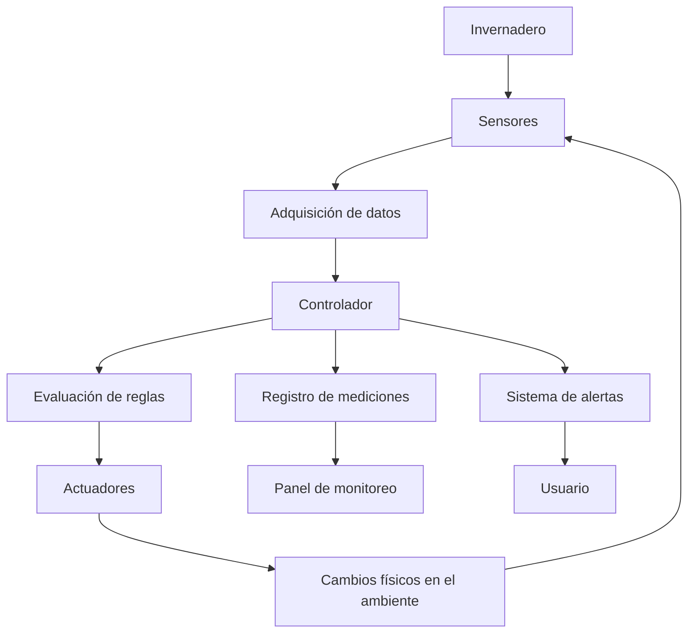
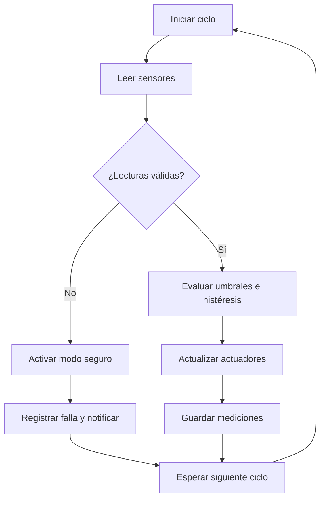
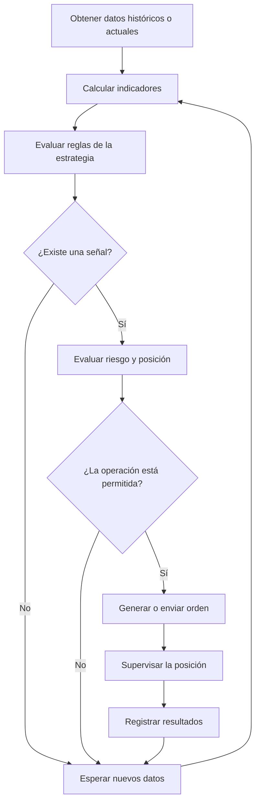
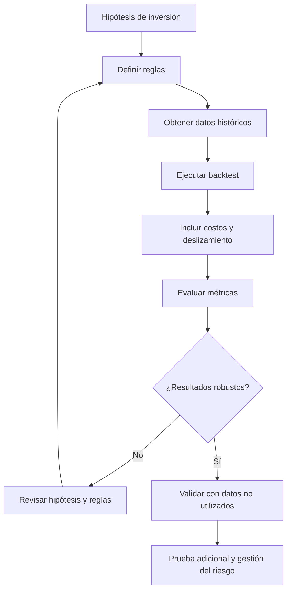
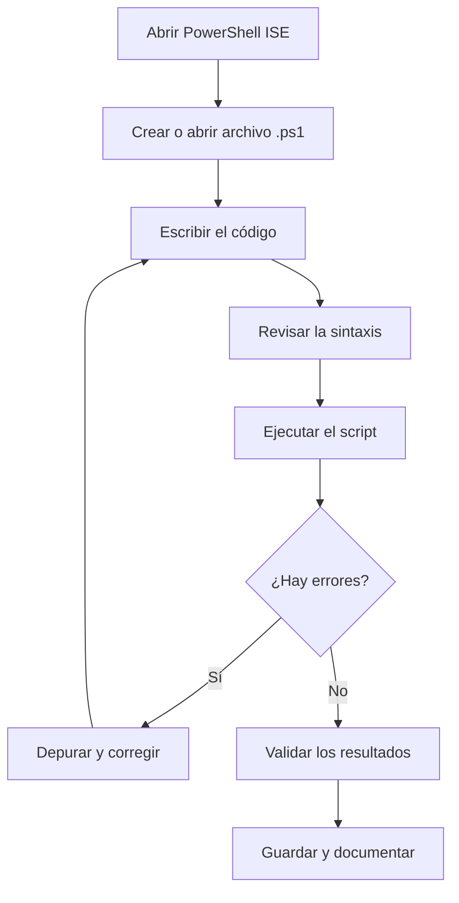
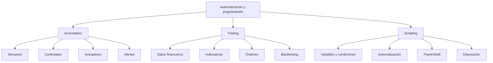

# Apuntes de Automatización, Trading y Scripting

# SECCIÓN 1: Automatización del Invernadero (Bot)

## 1.1. Introducción a la automatización

### ¿Qué es un Bot de Automatización?

Un **Bot de Automatización** es un sistema programable capaz de ejecutar tareas de manera automática a partir de instrucciones previamente definidas.

En un invernadero, el bot puede medir las condiciones ambientales, procesar la información, tomar decisiones y controlar dispositivos para mantener condiciones adecuadas para el crecimiento de las fresas.

Se considera un sistema embebido cuando utiliza un dispositivo electrónico dedicado, como un ESP32 o Arduino, para realizar funciones específicas.

**Objetivos principales:**

- Automatizar el riego y la ventilación.
    
- Supervisar temperatura, humedad e iluminación.
    
- Reducir el desperdicio de agua y energía.
    
- Detectar condiciones anormales.
    
- Enviar notificaciones al usuario.
    
- Mantener condiciones adecuadas para cada etapa del cultivo.
    

### Conceptos fundamentales

|Concepto|Definición|
|---|---|
|Sistema embebido|Sistema informático integrado en un dispositivo para realizar tareas específicas.|
|Control en tiempo real|Sistema que responde a los eventos dentro de un tiempo determinado. No significa necesariamente que responda de forma instantánea.|
|Sensor|Dispositivo que mide una variable física o química.|
|Controlador|Unidad que procesa las mediciones y determina qué acciones realizar.|
|Actuador|Dispositivo que ejecuta una acción física, como abrir una válvula o encender un ventilador.|
|Firmware|Programa que controla el funcionamiento del dispositivo electrónico.|
|Telemetría|Recopilación y transmisión de mediciones para supervisión y análisis.|

## 1.2. Arquitectura y ciclo de control

### Ciclo de control cerrado

Un sistema de control cerrado mide el resultado de sus acciones mediante sensores y utiliza esa información para ajustar su comportamiento.

Por ejemplo, si la humedad del sustrato es demasiado baja, el controlador activa el riego. Después, vuelve a medir la humedad para determinar si debe mantenerlo encendido o apagarlo.

### Mapa conceptual: arquitectura general



**Interpretación del mapa:**

1. Los sensores miden las condiciones del invernadero.
    
2. El controlador recibe las mediciones.
    
3. El programa compara los valores con los umbrales establecidos.
    
4. Los actuadores modifican las condiciones físicas.
    
5. Los sensores vuelven a medir para comprobar el resultado.
    

Este proceso se repite continuamente.

### Arquitectura por bloques

**Entradas → Procesamiento → Salidas**

- **Entradas:** temperatura, humedad del aire, humedad del suelo, luz y otras mediciones.
    
- **Procesamiento:** validación de datos, comparación de umbrales y ejecución de reglas.
    
- **Salidas:** bombas, electroválvulas, ventiladores, luminarias y notificaciones.
    

## 1.3. Tipos de sensores

### Sensor ambiental: DHT22 y BME280

Miden variables ambientales que ayudan a determinar si las condiciones del invernadero son adecuadas.

- **DHT22:** mide temperatura y humedad relativa del aire.
    
- **BME280:** mide temperatura, presión atmosférica y humedad relativa.
    

### Sensor capacitivo de humedad del suelo

Estima el contenido de humedad del sustrato mediante sus propiedades eléctricas.

**Función:** determinar cuándo conviene iniciar o detener el riego.

La lectura debe calibrarse según el sustrato utilizado. Un porcentaje mostrado por el programa no equivale necesariamente al porcentaje real de agua del suelo.

### Sensor de luz: LDR y BH1750

- **LDR:** cambia su resistencia eléctrica según la intensidad luminosa.
    
- **BH1750:** mide la iluminancia en lux.
    

**Aplicaciones:**

- Encender iluminación suplementaria.
    
- Supervisar la iluminación disponible.
    
- Activar sistemas de sombreado cuando corresponda.
    

### Sensores de pH y conductividad eléctrica (EC)

- **pH:** indica si una solución es ácida, neutra o alcalina.
    
- **EC:** mide la conductividad eléctrica, utilizada como indicador de la concentración de sustancias iónicas disueltas.
    

Son útiles para supervisar el agua de riego y las soluciones nutritivas, especialmente en sistemas hidropónicos.

### Sensores complementarios

|Sensor|Utilidad|
|---|---|
|Sensor de temperatura del sustrato|Supervisar las condiciones de las raíces.|
|Sensor de nivel de agua|Detectar un tanque vacío o un nivel insuficiente.|
|Caudalímetro|Comprobar si circula agua durante el riego.|
|Sensor de lluvia|Apoyar decisiones sobre ventanas y riego exterior.|
|Anemómetro|Medir la velocidad del viento.|
|Sensor de drenaje|Supervisar el volumen de agua drenada.|

## 1.4. Microcontroladores y controladores

El controlador es el componente que procesa las mediciones y ejecuta las reglas de automatización.

|Dispositivo|Características y usos|
|---|---|
|Arduino|Adecuado para aprender electrónica y controlar sensores y actuadores.|
|ESP32|Microcontrolador con conectividad Wi-Fi y Bluetooth en muchas de sus variantes.|
|Raspberry Pi|Computadora de placa única útil para interfaces, bases de datos y procesamiento más complejo.|
|PLC|Controlador industrial diseñado para automatizar procesos con requisitos de robustez y confiabilidad.|

**Diferencia importante:** Arduino y ESP32 suelen emplearse como microcontroladores. Raspberry Pi funciona normalmente como una computadora de placa única. Un PLC está orientado al control industrial.

## 1.5. Lógica de control y firmware

El firmware contiene las instrucciones que ejecuta el controlador.

Un ciclo básico de ejecución comprende:

1. Leer los sensores.
    
2. Validar que las mediciones sean correctas.
    
3. Comparar las mediciones con los umbrales.
    
4. Determinar las acciones necesarias.
    
5. Activar o desactivar los actuadores.
    
6. Registrar los resultados.
    
7. Esperar el siguiente ciclo y repetir.
    

### Histéresis

La **histéresis** utiliza distintos umbrales para encender y apagar un dispositivo. Evita que un actuador cambie de estado repetidamente cuando una medición fluctúa cerca de un único límite.

Por ejemplo, para la ventilación:

- Encender cuando la temperatura supere los 28 °C.
    
- Apagar cuando la temperatura descienda por debajo de los 26 °C.
    
- Mantener el estado anterior mientras la temperatura esté entre ambos valores.
    

Los valores son ilustrativos; deben ajustarse al cultivo y al diseño del invernadero.

### Mapa de decisiones del controlador



## 1.6. Actuadores y dispositivos de salida

Los actuadores transforman las decisiones del controlador en acciones físicas.

|Actuador|Función|
|---|---|
|Bomba de agua|Impulsar el agua de riego.|
|Electroválvula|Abrir o cerrar el paso del agua.|
|Extractor de aire|Favorecer la ventilación.|
|Nebulizador o fogger|Producir pequeñas gotas de agua para aumentar la humedad ambiental.|
|Luminaria LED|Proporcionar iluminación suplementaria.|
|Motor de cortina|Abrir o cerrar cortinas laterales.|
|Malla de sombreado motorizada|Reducir la radiación solar incidente.|
|Relé o controlador de potencia|Conmutar cargas eléctricas compatibles con sus especificaciones.|

**Precaución:** los motores, bombas y cargas de potencia deben contar con interfaces eléctricas adecuadas. No deben conectarse directamente a los pines de un microcontrolador si exceden sus límites eléctricos.

## 1.7. Umbrales y reglas de automatización

Los umbrales son valores que permiten al controlador determinar cuándo debe ejecutar una acción.

|Variable|Regla ilustrativa|Acción|
|---|---|---|
|Temperatura del aire|Mayor que 28 °C|Activar ventilación.|
|Temperatura del aire|Menor que 15 °C|Evaluar activar calefacción.|
|Humedad del sustrato|Menor que 40 % calibrado|Solicitar riego.|
|Iluminancia|Menor que 500 lux durante el periodo de iluminación|Activar iluminación suplementaria.|
|Nivel del tanque|Por debajo del mínimo seguro|Bloquear la bomba y generar una alerta.|

Estos valores son ejemplos de programación, no recomendaciones agronómicas universales. Los límites reales deben definirse según la variedad de fresa, la etapa del cultivo, el sustrato y las condiciones ambientales.

### Ejemplo de estado normal

- Temperatura del aire: 24 °C.
    
- Humedad del sustrato: 65 % según la calibración utilizada.
    
- No hay sensores defectuosos.
    
- No se requiere riego ni ventilación adicional.
    

**Resultado:** el sistema mantiene los actuadores apagados cuando no se necesita intervenir.

## 1.8. Ejemplo de pseudocódigo en Python

El siguiente ejemplo ilustra el funcionamiento del controlador. Las funciones de sensores y actuadores son representativas: deben implementarse para el hardware real.

```
# Umbrales ilustrativos
HUMEDAD_MIN = 40
TEMP_VENTILACION_ON = 28
TEMP_VENTILACION_OFF = 26

ventilacion_activa = False

while True:
    humedad = sensor_suelo.leer()
    temperatura = sensor_temp.leer()

    # Validar las mediciones antes de controlar
    if humedad is None or temperatura is None:
        bomba_riego.apagar()
        extractor_aire.apagar()
        bot.notificar("Alerta: sensor sin lectura")
        esperar(5)
        continue

    # Control del riego
    if humedad < HUMEDAD_MIN:
        bomba_riego.encender()
    else:
        bomba_riego.apagar()

    # Control de ventilación con histéresis
    if temperatura > TEMP_VENTILACION_ON:
        ventilacion_activa = True
    elif temperatura < TEMP_VENTILACION_OFF:
        ventilacion_activa = False

    if ventilacion_activa:
        extractor_aire.encender()
    else:
        extractor_aire.apagar()

    esperar(5)
```

**Observaciones:**

- `sensor_suelo.leer()` representa la lectura de un sensor.
    
- `bomba_riego.encender()` representa la activación de una bomba.
    
- `bot.notificar()` representa una función de notificación que debe programarse.
    
- `esperar(5)` representa una pausa de cinco segundos.
    
- El código no implementa todavía la calibración, la detección de bomba averiada ni todos los mecanismos de seguridad.
    

En un sistema real, la bomba también debe protegerse contra el funcionamiento en seco y el riego excesivo.

## 1.9. Monitoreo, notificaciones y comunicación

El sistema puede transmitir información para que el usuario supervise el invernadero.

### Tecnologías posibles

- **Telegram Bot:** permite enviar alertas y mensajes.
    
- **WhatsApp:** puede integrarse mediante servicios o interfaces autorizadas.
    
- **MQTT:** protocolo ligero de mensajería muy utilizado en sistemas IoT.
    
- **Panel web:** permite consultar gráficas, estados y mediciones.
    
- **Registro local:** almacena mediciones y eventos para su revisión posterior.
    

### Tipos de alertas

|Condición|Posible alerta|
|---|---|
|Temperatura excesiva|Riesgo de estrés térmico.|
|Temperatura demasiado baja|Posible daño por frío.|
|Humedad elevada durante mucho tiempo|Posible aumento del riesgo de enfermedades fúngicas.|
|Sensor sin respuesta|Revisar conexión o reemplazar el sensor.|
|Bomba activa sin flujo de agua|Posible falla de la bomba, obstrucción o falta de agua.|
|EC demasiado alta|Revisar la concentración de sales de la solución nutritiva.|

Las alertas se generan a partir de los datos existentes y sus reglas de evaluación; no son sensores adicionales.

## 1.10. Indicadores para el diseño del invernadero

Un indicador es una variable medida o calculada que ayuda a evaluar el estado del cultivo.

No existe una cantidad universal de indicadores que garantice un buen sistema. Se deben seleccionar según el objetivo y los riesgos del proyecto.

### Indicadores básicos

1. Temperatura del aire.
    
2. Humedad relativa del aire.
    
3. Humedad del sustrato.
    
4. Iluminancia.
    
5. Nivel del tanque.
    
6. Estado del riego.
    
7. Estado de la ventilación.
    
8. Estado de los sensores.
    

### Indicadores complementarios

- Temperatura del sustrato.
    
- Déficit de presión de vapor (DPV).
    
- pH de la solución nutritiva.
    
- Conductividad eléctrica (EC).
    
- Volumen de agua aplicado.
    
- Volumen de drenaje.
    
- Temperatura exterior.
    
- Velocidad del viento.
    
- Consumo energético.
    

**Importante:** medir en un solo punto puede ocultar diferencias entre las distintas zonas del invernadero. Cuando el tamaño y el presupuesto lo justifiquen, conviene distribuir los sensores en lugares representativos.

### Déficit de presión de vapor (DPV)

El DPV expresa la diferencia entre la presión de vapor de saturación y la presión de vapor real del aire. Ayuda a interpretar la demanda evaporativa del ambiente.

Una aproximación habitual es:

[  
DPV = e_s(T)\left(1-\frac{HR}{100}\right)  
]

Donde:

- (DPV): déficit de presión de vapor.
    
- (e_s(T)): presión de vapor de saturación a la temperatura (T).
    
- (HR): humedad relativa expresada en porcentaje.
    

La unidad del DPV es normalmente kPa cuando (e_s) se expresa en kPa.

El DPV depende de la temperatura y la humedad relativa; no debe confundirse con una lectura directa de un sensor.

## 1.11. Calibración, mantenimiento y seguridad

### Calibración

La calibración permite relacionar las lecturas del sensor con valores de referencia.

- Calibrar los sensores de humedad del sustrato para el medio de cultivo real.
    
- Calibrar los sensores de pH con soluciones de referencia.
    
- Verificar los sensores de EC con soluciones patrón.
    
- Comparar periódicamente los sensores de temperatura y humedad con instrumentos de referencia.
    

### Seguridad ante fallas

El sistema debe prever situaciones como:

- Sensor desconectado o con lecturas imposibles.
    
- Tanque vacío.
    
- Bomba averiada.
    
- Caudal insuficiente.
    
- Válvula atascada.
    
- Pérdida de comunicación.
    
- Reinicio inesperado del controlador.
    

Ante una falla crítica, el sistema debe pasar a un estado seguro definido para cada dispositivo y notificar al usuario. Apagar todos los actuadores no siempre es seguro: la respuesta correcta depende del riesgo y del proceso.

### Control por etapa del cultivo

Las necesidades de las fresas cambian durante las etapas vegetativa, floración y fructificación. Por ello, los umbrales deben configurarse según la etapa y validarse con criterios agronómicos.

---

# SECCIÓN 2: Trading e Indicadores Financieros

## 2.1. Introducción al trading algorítmico

El **trading algorítmico** utiliza programas informáticos para analizar información financiera y, según las reglas programadas, generar señales o enviar órdenes de compra y venta.

Un algoritmo puede trabajar con:

- Acciones.
    
- Criptomonedas.
    
- Divisas.
    
- Índices y contratos financieros compatibles con la plataforma utilizada.
    

No todos los algoritmos operan automáticamente. Algunos solo analizan datos, otros generan señales y otros pueden enviar órdenes.

## 2.2. Flujo general de una estrategia



El flujo representa una arquitectura general. En una estrategia real también deben contemplarse comisiones, deslizamiento, disponibilidad de capital y posibles rechazos de órdenes.

## 2.3. Órdenes de compra y venta

Una orden es una instrucción enviada al mercado o al intermediario para realizar una operación.

|Tipo de orden|Descripción|
|---|---|
|Market Order|Solicita comprar o vender al mejor precio disponible. El precio final no está garantizado.|
|Limit Order|Establece un precio límite. Puede no ejecutarse si el mercado no alcanza las condiciones requeridas.|
|Stop Order|Se activa al alcanzar un precio de disparo, según las reglas del intermediario.|
|Stop-Limit Order|Combina un precio de activación y un precio límite; puede no ejecutarse tras activarse.|

La disponibilidad y el funcionamiento exacto de las órdenes dependen del mercado y del intermediario.

## 2.4. Stop Loss y Take Profit

### Stop Loss

Es una regla u orden destinada a limitar las pérdidas de una operación.

Por ejemplo, si se compra una acción a 100 y se establece un nivel de salida en 95, la pérdida prevista sería de 5 unidades monetarias por acción, antes de comisiones y deslizamiento.

El precio real de ejecución puede diferir del nivel establecido.

### Take Profit

Es una regla u orden destinada a cerrar una posición cuando se alcanza un objetivo de beneficio.

Por ejemplo:

- Precio de entrada: 100.
    
- Objetivo de beneficio: 110.
    
- Diferencia favorable prevista: 10 por acción, antes de costos.
    

Un objetivo de beneficio no garantiza que el mercado lo alcance ni que la orden se ejecute al precio esperado.

## 2.5. Indicadores financieros

Los indicadores se calculan a partir de datos de mercado y pueden utilizarse para estudiar tendencias, volatilidad o condiciones de sobrecompra y sobreventa.

|Indicador|Significado|Uso habitual|
|---|---|---|
|SMA|Media móvil simple|Identificar tendencias generales.|
|EMA|Media móvil exponencial|Dar mayor peso a los datos recientes.|
|RSI|Índice de fuerza relativa|Analizar el impulso del precio.|
|MACD|Convergencia/divergencia de medias móviles|Estudiar cambios de tendencia e impulso.|
|Bandas de Bollinger|Bandas calculadas alrededor de una media móvil|Analizar volatilidad relativa.|
|Volumen|Cantidad negociada durante un periodo|Evaluar la actividad del mercado.|
|ATR|Rango verdadero promedio|Estimar la volatilidad.|

Un indicador por sí solo no predice de manera fiable el movimiento futuro del mercado. Las señales deben evaluarse con reglas claras y pruebas apropiadas.

## 2.6. Ratios financieros

Los ratios permiten comparar el precio de una acción con otras variables financieras.

### Ratio precio-beneficio (P/E)

El ratio P/E compara el precio de una acción con el beneficio por acción:

[  
P/E = \frac{\text{Precio por acción}}{\text{Beneficio por acción}}  
]

Puede ayudar a comparar valoraciones entre empresas similares, pero debe interpretarse considerando el crecimiento, la deuda, el sector y la calidad de los beneficios.

**Nota:** si en el material original aparece «P Ratio» o «P/g Ratio», hay que verificar qué indicador pretendía el profesor. No son nombres suficientemente claros para asumir que se trata del P/E.

## 2.7. Filtrado de acciones

El filtrado permite seleccionar activos que cumplen determinados criterios.

Ejemplos de filtros:

- Precio mínimo o máximo.
    
- Volumen negociado.
    
- Capitalización bursátil.
    
- Tendencia de la media móvil.
    
- Volatilidad.
    
- Indicadores financieros.
    
- Resultados de pruebas históricas.
    

Un filtro reduce el universo de activos analizados, pero no garantiza que las acciones seleccionadas sean rentables.

## 2.8. Backtesting

El **backtesting** consiste en evaluar una estrategia utilizando datos históricos para estudiar cómo habría funcionado bajo las condiciones simuladas.

### Procedimiento general

1. Definir una hipótesis.
    
2. Establecer reglas de entrada y salida.
    
3. Seleccionar los activos y el periodo histórico.
    
4. Configurar capital, comisiones y otros costos.
    
5. Ejecutar la simulación.
    
6. Analizar los resultados.
    
7. Comparar la estrategia con una referencia apropiada.
    
8. Evaluar su robustez antes de considerar su uso real.
    

### Indicadores de evaluación

- Rentabilidad total.
    
- Rentabilidad anualizada.
    
- Máxima caída o _maximum drawdown_.
    
- Número de operaciones.
    
- Porcentaje de operaciones ganadoras.
    
- Relación entre beneficio y pérdida.
    
- Costos de operación.
    
- Sharpe Ratio, cuando corresponda.
    

### Mapa del proceso de backtesting



**Precauciones:**

- Un resultado histórico positivo no garantiza ganancias futuras.
    
- Evitar el sobreajuste a datos históricos.
    
- No utilizar información futura para tomar decisiones pasadas.
    
- Separar datos de desarrollo y validación.
    
- Considerar comisiones, deslizamiento y liquidez.
    

La expresión «Procedimiento 1 = Procedimiento 2» no es una regla general del backtesting. Si se pretende comparar dos estrategias, se deben definir métricas y criterios de comparación.

## 2.9. QuantConnect y Python

QuantConnect es una plataforma para desarrollar y probar algoritmos de inversión mediante su motor LEAN.

Un algoritmo Python de QuantConnect suele utilizar:

- `QCAlgorithm`: clase base del algoritmo.
    
- `Initialize` o `initialize`: configuración inicial, según la convención utilizada por el entorno.
    
- `AddEquity` o `add_equity`: suscripción a datos de acciones.
    
- `AddCrypto` o `add_crypto`: suscripción a datos de criptomonedas.
    
- `Resolution`: frecuencia de los datos.
    
- `OnData` o `on_data`: procesamiento de los datos recibidos.
    
- Métodos de órdenes: envío de instrucciones de compra o venta.
    

### Ejemplo de lectura de precios

```
from AlgorithmImports import *

class EjemploTrading(QCAlgorithm):

    def initialize(self):
        self.set_start_date(2020, 1, 1)
        self.set_end_date(2020, 12, 31)
        self.set_cash(100000)

        self.aapl = self.add_equity(
            "AAPL", Resolution.DAILY
        ).symbol

    def on_data(self, data: Slice):
        if data.contains_key(self.aapl):
            barra = data[self.aapl]

            if barra is not None:
                if barra.close > barra.open:
                    self.log(
                        f"Apple subió durante la sesión: "
                        f"{barra.close}"
                    )
```

Este ejemplo registra los días en los que el cierre de Apple supera su apertura. **No ejecuta compras ni ventas.**

`AlgorithmImports` pertenece al entorno de QuantConnect/LEAN. Para ejecutar este tipo de código se necesita el entorno correspondiente; no basta con ejecutar el archivo directamente con el Python del sistema.

---

# SECCIÓN 3: Scripting y PowerShell ISE

## 3.1. ¿Qué es un script?

Un **script** es un archivo de texto que contiene instrucciones escritas en un lenguaje de scripting. Un intérprete o entorno compatible procesa esas instrucciones para realizar tareas.

Los scripts se utilizan para automatizar operaciones repetitivas, procesar datos y administrar sistemas.

### Aplicaciones habituales

- Crear carpetas y organizar archivos.
    
- Realizar respaldos.
    
- Renombrar múltiples archivos.
    
- Instalar o configurar programas.
    
- Consultar información del sistema.
    
- Procesar registros y generar informes.
    
- Ejecutar tareas programadas.
    

## 3.2. Extensiones comunes de scripts

|Extensión|Lenguaje o tecnología|Uso habitual|
|---|---|---|
|`.bat`|Batch|Automatizar comandos de CMD en Windows.|
|`.cmd`|Batch|Ejecutar secuencias de comandos de Windows.|
|`.ps1`|PowerShell|Administración y automatización del sistema.|
|`.vbs`|VBScript|Automatización heredada en entornos Windows compatibles.|
|`.js`|JavaScript|Programas JavaScript en entornos compatibles.|
|`.py`|Python|Automatización, procesamiento de datos y desarrollo.|

La extensión identifica normalmente el tipo de archivo, pero no garantiza que el sistema tenga instalado el intérprete o que permita ejecutarlo.

## 3.3. Ejemplo de un script PowerShell

El siguiente script crea una carpeta de respaldo si todavía no existe:

```
# Definir la ruta de destino
$ruta = "C:\Respaldos"

# Comprobar si la carpeta existe
if (-not (Test-Path $ruta)) {

    # Crear la carpeta
    New-Item -Path $ruta -ItemType Directory

    Write-Host "Carpeta de respaldo creada."

} else {

    Write-Host "La carpeta ya existe."
}
```

### Explicación de los comandos

- `$ruta`: almacena una cadena de texto.
    
- `Test-Path`: comprueba si existe la ruta.
    
- `-not`: invierte el resultado lógico.
    
- `New-Item`: crea un elemento, en este caso una carpeta.
    
- `Write-Host`: muestra un mensaje en la consola.
    
- `if / else`: selecciona qué instrucciones ejecutar según una condición.
    

Este ejemplo crea una carpeta, pero no copia archivos ni realiza por sí solo un respaldo completo.

## 3.4. Variables, condiciones y bucles

### Variables

Almacenan información que puede utilizarse durante la ejecución del script.

```
$nombre = "Invernadero"
$temperatura = 30
```

### Condiciones

Permiten ejecutar instrucciones cuando se cumple una condición.

```
if ($temperatura -gt 28) {
    Write-Host "Temperatura elevada"
}
```

En PowerShell, `-gt` significa «mayor que».

Otros operadores comunes:

|Operador|Significado|
|---|---|
|`-eq`|Igual a|
|`-ne`|Diferente de|
|`-gt`|Mayor que|
|`-lt`|Menor que|
|`-ge`|Mayor o igual que|
|`-le`|Menor o igual que|

### Bucles

Permiten repetir instrucciones.

```
for ($i = 1; $i -le 5; $i++) {
    Write-Host "Iteración $i"
}
```

El bucle muestra cinco iteraciones, desde la primera hasta la quinta.

## 3.5. Seguridad y políticas de ejecución

Los scripts pueden modificar archivos, cambiar configuraciones, instalar programas o ejecutar comandos destructivos. Por ello, es importante revisar su contenido antes de ejecutarlos.

### Execution Policy

PowerShell dispone de políticas de ejecución que determinan cómo se tratan determinados archivos de script.

Un ejemplo de configuración para el usuario actual en Windows es:

```
Set-ExecutionPolicy -Scope CurrentUser RemoteSigned
```

Esta configuración permite ejecutar scripts locales y aplica requisitos de firma a determinados scripts descargados, según su origen y las reglas del sistema.

**Importante:**

- No elimina todos los riesgos de seguridad.
    
- No debe utilizarse para ejecutar scripts desconocidos sin revisarlos.
    
- Las políticas disponibles y su aplicación dependen de la versión y la configuración del equipo.
    
- Las políticas establecidas por la organización pueden tener prioridad.
    

Para consultar la configuración actual:

```
Get-ExecutionPolicy -List
```

## 3.6. ¿Qué es PowerShell ISE?

PowerShell ISE significa **Integrated Scripting Environment** (Entorno de scripting integrado).

Es un entorno gráfico de Microsoft diseñado para escribir, editar, ejecutar y depurar scripts de Windows PowerShell.

Se introdujo con Windows PowerShell 2.0 y permite trabajar con código y consola en una misma interfaz.

### Funcionalidades principales

- Editor de scripts con resaltado de sintaxis.
    
- Ejecución de comandos y bloques de código.
    
- Depuración paso a paso.
    
- Puntos de interrupción (_breakpoints_).
    
- Inspección de variables.
    
- Identificación de errores durante la ejecución.
    
- Prueba de instrucciones antes de integrarlas en un script mayor.
    

### Depuración

La depuración consiste en ejecutar o inspeccionar el programa de manera controlada para detectar errores.

Un punto de interrupción permite pausar la ejecución en una línea determinada para examinar el estado del programa.

## 3.7. Flujo de trabajo en PowerShell ISE



## 3.8. Limitaciones y alternativas modernas

PowerShell ISE es una herramienta heredada y está vinculada a Windows PowerShell. No se desarrolla como el entorno principal para las versiones modernas de PowerShell.

Para nuevos proyectos, conviene conocer:

- **Visual Studio Code:** editor extensible que puede utilizarse con la extensión de PowerShell.
    
- **PowerShell 7:** versión moderna de PowerShell, disponible para Windows, Linux y macOS.
    
- **Terminal:** permite ejecutar PowerShell y otras herramientas de línea de comandos.
    

PowerShell ISE no es el entorno adecuado para desarrollar directamente con PowerShell 7. En sistemas Linux, como Linux Mint, se puede instalar PowerShell y ejecutar scripts `.ps1` compatibles desde la terminal, pero no se utiliza la interfaz gráfica de ISE.

---

# RESUMEN GENERAL

|Tema|Concepto central|Aplicación|
|---|---|---|
|Automatización del invernadero|Sensores, controlador y actuadores|Mantener condiciones adecuadas para el cultivo.|
|Trading algorítmico|Datos, reglas e indicadores|Analizar el mercado y evaluar estrategias.|
|Backtesting|Simulación con datos históricos|Estudiar el comportamiento pasado de una estrategia.|
|Scripting|Instrucciones ejecutadas por un intérprete|Automatizar tareas repetitivas.|
|PowerShell ISE|Entorno de edición y depuración|Desarrollar y probar scripts de Windows PowerShell.|

## Mapa general de los tres temas



