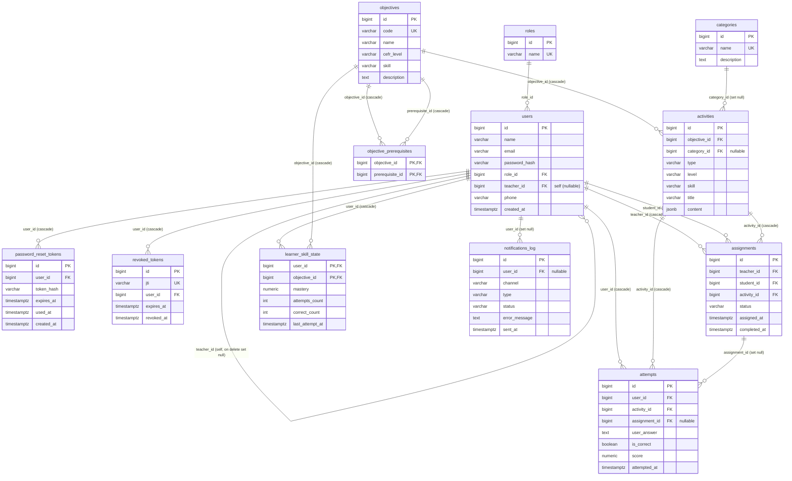

# Diagrama ER - English Lab

Diagrama entidad-relacion (Mermaid `erDiagram`) del esquema gestionado por Flyway
(V1-V4). 12 tablas: `roles`, `users`, `password_reset_tokens`, `revoked_tokens`,
`objectives`, `objective_prerequisites`, `activities`, `categories`, `assignments`,
`attempts`, `learner_skill_state`, `notifications_log`.

## Notas de integridad

- `users.email` es unico de forma **case-insensitive**: indice unico sobre `lower(email)`.
- `objective_prerequisites` tiene PK compuesta `(objective_id, prerequisite_id)` y
  `CHECK (objective_id <> prerequisite_id)`. El grafo es **aciclico**.
- `learner_skill_state` tiene PK compuesta `(user_id, objective_id)`.
- `activities.content` es `jsonb`; guarda `answer`/`accepted` (la clave) y `explanation`.
  El DTO de estudiante nunca expone esos campos.
- FK con `on delete` explicito: `cascade` para dependientes fuertes, `set null` para
  referencias opcionales (`users.teacher_id`, `attempts.assignment_id`,
  `activities.category_id`, `notifications_log.user_id`).
